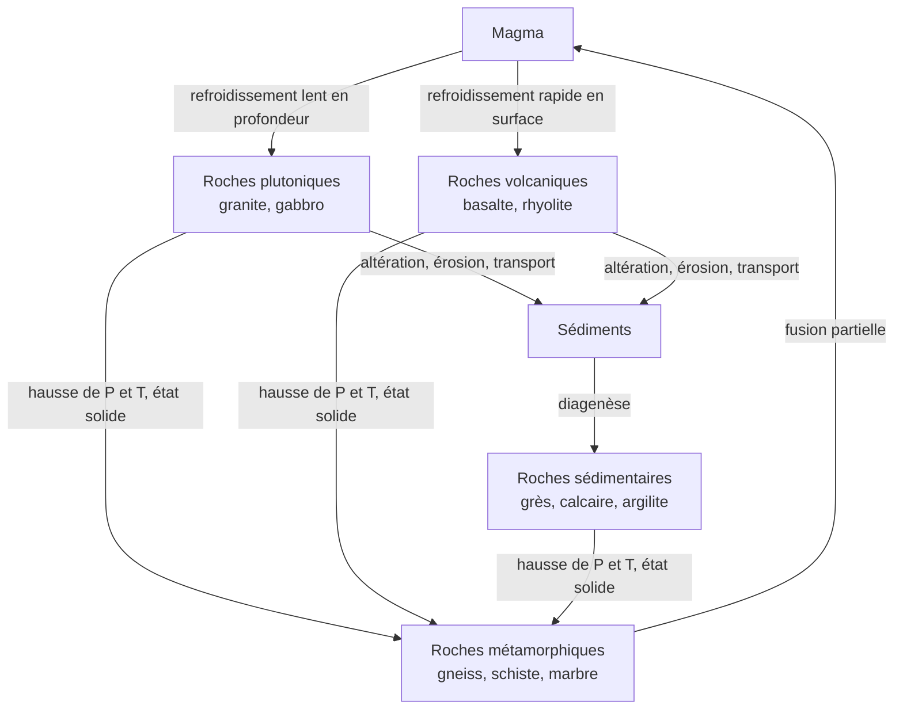
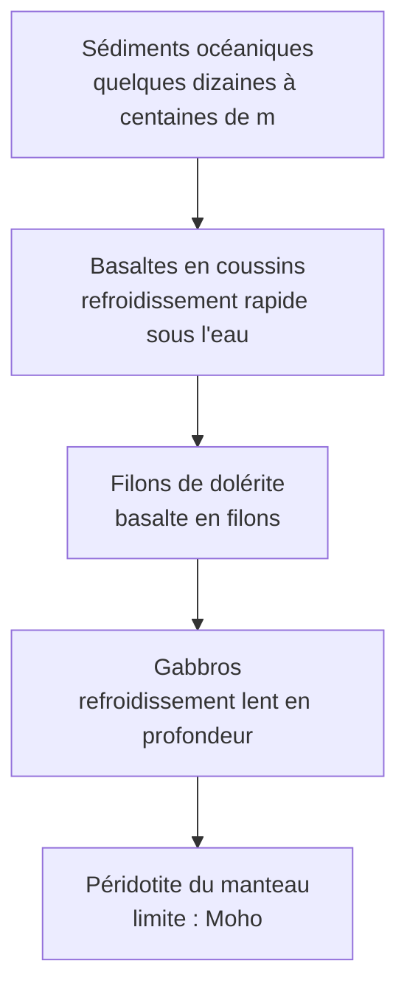

# B. Roches de la croûte continentale et de la croûte océanique

## 1. Les différents types de roches

### 1.1 Définitions de base

!!! info "Définitions"
    - **Minéral** : solide naturel cristallisé, de composition chimique définie (quartz $\text{SiO}_2$, par exemple).
    - **Roche** : assemblage de minéraux (et parfois de verre) formant un ensemble naturel.
    - **Texture** (ou structure) : manière dont les minéraux sont organisés et leur taille. Elle renseigne sur les **conditions de formation**.
    - **Composition minéralogique** : liste et proportion des minéraux présents.
    - **Magma** : roche en fusion (partielle ou totale), mélange de liquide silicaté, de cristaux et de gaz.

### 1.2 Les trois grandes familles

#### a) Roches sédimentaires

!!! info "Définition"
    Roches formées à la **surface** de la Terre par **accumulation de sédiments** (fragments de roches, restes d'organismes, précipités chimiques) puis transformation en roche solide (**diagenèse** : compaction et cimentation).

- **Détritiques** : issues de fragments de roches préexistantes (argilite, grès, conglomérat).
- **Biogéniques** : issues de restes d'organismes (calcaire bioclastique, craie, charbon).
- **Chimiques** : issues de précipitations (évaporites : gypse, sel gemme).
- **Indices** : disposition en **strates** (couches), présence éventuelle de **fossiles**, formation à basse température et basse pression.

#### b) Roches magmatiques

!!! info "Définition"
    Roches formées par **refroidissement et cristallisation d'un magma**. La **vitesse de refroidissement** détermine la texture.

| Type | Lieu de refroidissement | Vitesse | Texture | Exemples |
|---|---|---|---|---|
| **Plutonique** | en profondeur | lente | **grenue** : cristaux visibles à l'œil nu, jointifs | granite, gabbro, diorite |
| **Volcanique** | en surface ou près de la surface | rapide | **microlitique** : petits cristaux (microlites) ± verre, parfois quelques gros cristaux (phénocristaux) | basalte, andésite, rhyolite |

!!! warning "Point d'attention"
    **Gabbro** (plutonique, grenu) et **basalte** (volcanique, microlitique) ont la **même composition chimique** et à peu près les mêmes minéraux. Ce qui les distingue, c'est la **texture**, donc la **vitesse de refroidissement**.

#### c) Roches métamorphiques

!!! info "Définition"
    Roches issues de la **transformation à l'état solide** d'une roche préexistante, sous l'effet d'une **augmentation de température et/ou de pression**, sans fusion. Les **minéraux** changent (apparition de nouveaux minéraux) et/ou se **réorganisent**.

- Texture fréquente : **foliation** (minéraux alignés en lits ou en feuillets) ; schistosité pour les roches finement feuilletées.
- Exemples : schiste, micaschiste, **gneiss**, marbre (calcaire métamorphisé), quartzite.
- Les minéraux caractéristiques (grenat, disthène, staurotide…) indiquent les conditions de pression et de température atteintes.

!!! warning "Piège classique : métamorphisme et fusion"
    Si la roche **fond** vraiment, on n'est plus en métamorphisme : on entre dans le domaine **magmatique**. Le métamorphisme se déroule **à l'état solide**.

## 2. Composition minéralogique d'un granite, d'un gneiss et d'un basalte

### 2.1 Minéraux à connaître

| Minéral | Formule indicative | Observation (échantillon / lame mince) |
|---|---|---|
| **Quartz** | $\text{SiO}_2$ | gris, transparent à translucide, **pas de clivage**, éclat vitreux ; en lame mince en lumière polarisée : gris-blanc |
| **Feldspaths potassiques** | $\text{KAlSi}_3\text{O}_8$ | blancs ou rosés ; clivages |
| **Plagioclases** | $\text{NaAlSi}_3\text{O}_8$ à $\text{CaAl}_2\text{Si}_2\text{O}_8$ | blancs à gris ; **macles** (stries parallèles) en lumière polarisée |
| **Micas** (biotite, muscovite) | silicates en feuillets | **biotite** noire brillante, **muscovite** claire ; se débitent en lamelles |
| **Amphiboles** | silicates ferromagnésiens | sombres, prismes allongés |
| **Pyroxènes** | silicates ferromagnésiens | sombres, verdâtres à noirs |
| **Olivine** | $(\text{Mg},\text{Fe})_2\text{SiO}_4$ | vert olive, grains ; en lame mince : couleurs vives en lumière polarisée |

### 2.2 Tableau comparatif

| Roche | Famille | Texture | Minéraux principaux | Couleur d'ensemble | Teneur en $\text{SiO}_2$ | Masse volumique |
|---|---|---|---|---|---|---|
| **Granite** | magmatique **plutonique** | **grenue** | quartz, feldspaths potassiques, plagioclases, micas (biotite, muscovite), parfois amphibole | **claire** | environ $70\ \%$ | $\approx 2{,}7\ \text{g·cm}^{-3}$ |
| **Gneiss** | **métamorphique** | **foliée** : lits clairs et lits sombres | quartz, feldspaths, plagioclases, micas (± amphibole, grenat) | claire à moyenne, **rubanée** | environ $65$ à $70\ \%$ | $\approx 2{,}7\ \text{g·cm}^{-3}$ |
| **Basalte** | magmatique **volcanique** | **microlitique** (± phénocristaux, ± verre) | plagioclases, **pyroxènes**, olivine, oxydes de fer-titane | **sombre** | environ $50\ \%$ | $\approx 2{,}9$ à $3{,}0\ \text{g·cm}^{-3}$ |

!!! abstract "À retenir"
    - Le **granite** et le **gneiss** ont à peu près **la même composition minéralogique** (quartz, feldspaths, micas) : seule diffère l'**organisation** (grenue aléatoire contre foliée).
    - Le **basalte** est **pauvre en quartz** et **riche en minéraux ferromagnésiens** (pyroxènes, olivine) : il est plus sombre et plus dense.
    - Ordre de densité : **basalte > granite ≈ gneiss**.

### 2.3 Lien gneiss et granite

Un granite soumis à de fortes pressions et températures peut devenir un gneiss : on parle d'**orthogneiss** quand la roche d'origine est magmatique (**paragneiss** quand elle est sédimentaire). Les minéraux ne changent presque pas, mais ils se **réorganisent en lits**.

!!! warning "Erreurs fréquentes"
    - Dire que le gneiss « est un granite » : il en **dérive** parfois, mais c'est une roche **métamorphique** (texture foliée).
    - Écrire « grenu » pour le basalte : c'est **microlitique**.
    - Affirmer que le granite contient de l'olivine : l'olivine est **absente** d'un granite typique (elle est caractéristique des roches **ferromagnésiennes**, basalte et péridotite).
    - Confondre **foliation** (organisation des minéraux d'une roche métamorphique) et **stratification** (couches d'une roche sédimentaire).

## 3. Roches caractéristiques de la croûte continentale

!!! abstract "Propriété"
    La croûte continentale est formée **principalement de roches de type granitoïdes** (granite, granodiorite) et de **roches métamorphiques** (gneiss, micaschistes), recouvertes localement d'une **couverture sédimentaire** (qui peut être épaisse mais discontinue).

- **Épaisseur moyenne** : environ $30$ à $35\ \text{km}$ (jusqu'à $70\ \text{km}$ sous les grandes chaînes de montagnes).
- **Masse volumique moyenne** : environ $2{,}7\ \text{g·cm}^{-3}$.
- **Âge** : très variable, **jusqu'à environ $4\ \text{Ga}$** pour les plus anciens fragments.
- **Composition d'ensemble** : riche en silice, aluminium, sodium et potassium ; roches **claires**.

## 4. Roches caractéristiques de la croûte océanique

!!! abstract "Propriété"
    La croûte océanique est constituée, de haut en bas, de : **sédiments** (couverture très variable), **basaltes** (souvent en **coussins**, dits *pillow-lavas*), un niveau de **filons** (dolérites), puis des **gabbros**. Elle repose sur le **manteau**, formé de **péridotite**.

- **Épaisseur moyenne** : environ $7\ \text{km}$.
- **Masse volumique moyenne** : environ $2{,}9$ à $3{,}0\ \text{g·cm}^{-3}$.
- **Âge** : **jeune**, au plus environ $180$ à $200\ \text{Ma}$.
- **Composition** : roches **sombres**, riches en fer et magnésium, pauvres en silice (basalte et gabbro).

!!! warning "Point d'attention"
    - Les **sédiments** forment une simple **couverture** de la croûte océanique, pas sa composition principale.
    - Basaltes (**en haut**) et gabbros (**en bas**) ont une **même composition chimique** mais des **textures différentes** : le refroidissement est **rapide** près du fond de l'océan, **lent** plus profond.
    - La **péridotite** appartient au **manteau**, pas à la croûte.

### Comment connaît-on ces roches ?

- **Dragages** et **submersibles** : échantillons prélevés sur le plancher océanique.
- **Forages** océaniques (profondeur limitée : quelques kilomètres, la croûte océanique complète n'a pas été traversée).
- **Ophiolites** : fragments de croûte océanique et de manteau **remontés sur les continents** (Alpes, Oman, Chypre) ; elles permettent d'observer la **coupe complète**.
- **Ondes sismiques** : donnent l'**épaisseur** et des indications sur la nature (voir la partie 2 du chapitre).

## 5. Tableau de synthèse

| Critère | Croûte **continentale** | Croûte **océanique** |
|---|---|---|
| Roches dominantes | granitoïdes, gneiss (+ couverture sédimentaire) | basalte, dolérite, gabbro (+ sédiments) |
| Aspect | claires | sombres |
| Épaisseur moyenne | $30$ à $35\ \text{km}$ (jusqu'à $70\ \text{km}$) | $\approx 7\ \text{km}$ |
| Masse volumique | $\approx 2{,}7\ \text{g·cm}^{-3}$ | $\approx 2{,}9$ à $3{,}0\ \text{g·cm}^{-3}$ |
| Âge maximal | $\approx 4\ \text{Ga}$ | $\approx 180$ à $200\ \text{Ma}$ |
