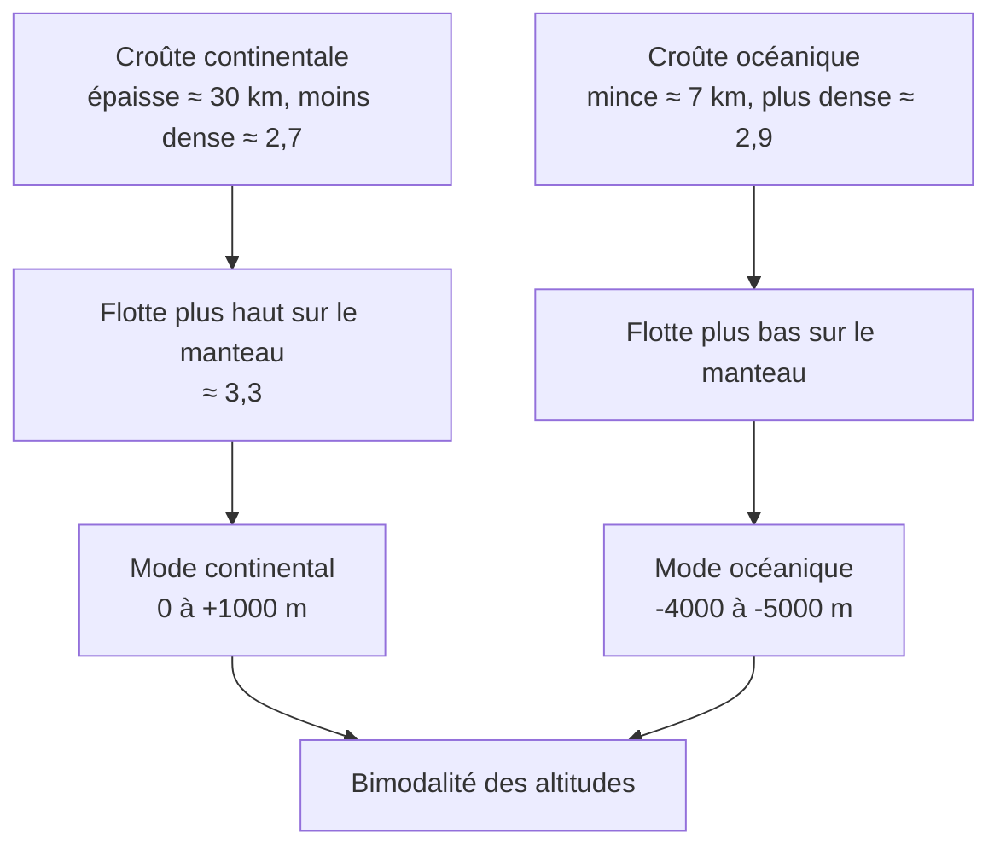

# C. Lien entre la bimodalité et la nature des roches

## 1. Problème posé

!!! question "Question"
    Pourquoi la surface de la Terre est-elle organisée en **deux ensembles d'altitudes** (continents vers $+840\ \text{m}$, fonds océaniques vers $-4000\ \text{m}$) plutôt qu'en une seule distribution continue ?

## 2. Deux croûtes de nature différente

Les parties A et B donnent deux informations :

1. la surface du globe présente **deux populations d'altitudes** ;
2. il existe **deux types de croûte** aux caractéristiques différentes.

| | Croûte continentale | Croûte océanique |
|---|---|---|
| Roches | granitoïdes, gneiss | basalte, gabbro |
| Épaisseur | $30$ à $35\ \text{km}$ | $\approx 7\ \text{km}$ |
| Masse volumique | $\approx 2{,}7\ \text{g·cm}^{-3}$ | $\approx 2{,}9\ \text{g·cm}^{-3}$ |
| Altitude du mode | $0$ à $+1000\ \text{m}$ | $-4000$ à $-5000\ \text{m}$ |

!!! abstract "Résultat"
    **À chaque type de croûte correspond un niveau d'altitude** : la croûte continentale, épaisse et peu dense, forme les **reliefs hauts** ; la croûte océanique, mince et plus dense, forme les **reliefs bas**. La bimodalité des altitudes est donc la **conséquence** de l'existence de **deux types de croûte**.

## 3. Pourquoi la croûte épaisse et légère se retrouve-t-elle plus haut ?

### 3.1 Modèle : les croûtes « flottent » sur le manteau

Sous la croûte se trouve le **manteau** (péridotite), de masse volumique d'environ $3{,}3\ \text{g·cm}^{-3}$, plus dense que les deux croûtes. Comme un morceau de bois flotte sur l'eau, la croûte, **moins dense** que le manteau, « flotte » sur lui. Plus la croûte est **épaisse** et **légère**, plus elle **dépasse** vers le haut.

!!! info "Définition : équilibre isostatique (modèle simple)"
    Dans le modèle d'**isostasie** (modèle d'Airy), les différentes colonnes de croûte sont **en équilibre** sur le manteau : à une profondeur de compensation $D$ située dans le manteau, **la pression est la même** sous toutes les colonnes, donc **le poids des colonnes de matière situées au-dessus est le même**.

!!! note "Niveau du programme"
    En première, on attend surtout le **raisonnement qualitatif** (densité plus faible et épaisseur plus grande de la croûte continentale, donc altitude plus élevée). Le calcul ci-dessous est un **approfondissement** qui permet de **vérifier quantitativement** le raisonnement, et d'obtenir un résultat très utile pour la suite.

### 3.2 Démonstration

On compare deux colonnes de même section, jusqu'à la même profondeur de compensation $D$ mesurée depuis le niveau de la mer.

- Colonne **continentale** : croûte d'épaisseur $h_c$, de masse volumique $\rho_c$, dont le sommet est à l'altitude $+e$ ; le manteau (masse volumique $\rho_m$) complète la colonne.
- Colonne **océanique** : eau de profondeur $w$ (masse volumique $\rho_e$), croûte d'épaisseur $h_o$ ($\rho_o$), puis manteau.

L'égalité des pressions (donc des masses des colonnes, la section et $g$ étant les mêmes) donne :

$$
\rho_c\, h_c + \rho_m\,\bigl(D - h_c + e\bigr) \;=\; \rho_e\, w + \rho_o\, h_o + \rho_m\,\bigl(D - w - h_o\bigr)
$$

On simplifie par $\rho_m D$, puis on isole $e$ :

$$
e \;=\; \frac{h_c\,(\rho_m-\rho_c)\;-\;h_o\,(\rho_m-\rho_o)\;-\;w\,(\rho_m-\rho_e)}{\rho_m}
$$

!!! tip "Lecture de la formule"
    - Plus $h_c$ est grand (croûte épaisse), plus $e$ est grand : les **montagnes ont des racines**.
    - Plus $\rho_c$ est proche de $\rho_m$, plus $e$ diminue : une croûte **dense** « flotte » moins haut.
    - Le terme $w\,(\rho_m-\rho_e)$ montre que l'**eau** (peu dense) **ajoute** un « manque de poids » dans la colonne océanique.

### 3.3 Application numérique

Données : $h_c = 30\ \text{km}$, $\rho_c = 2{,}8\ \text{g·cm}^{-3}$, $h_o = 7\ \text{km}$, $\rho_o = 2{,}9\ \text{g·cm}^{-3}$, $w = 3{,}8\ \text{km}$, $\rho_e = 1{,}03\ \text{g·cm}^{-3}$, $\rho_m = 3{,}3\ \text{g·cm}^{-3}$.

$$
e = \frac{30\times 0{,}5 \;-\; 7\times 0{,}4 \;-\; 3{,}8\times 2{,}27}{3{,}3} = \frac{15 - 2{,}8 - 8{,}626}{3{,}3} \approx 1{,}1\ \text{km}
$$

Le modèle prédit donc une altitude continentale de **l'ordre du kilomètre**, ce qui est cohérent avec l'altitude moyenne observée (environ $+840\ \text{m}$) : l'écart d'altitude entre continents et fonds océaniques (environ $4{,}6\ \text{km}$ au total) s'explique bien par les **différences d'épaisseur et de masse volumique** des croûtes.

!!! warning "Point d'attention"
    - Les valeurs numériques sont des **données de modèle** : en contrôle, elles sont **fournies**. Tu ne dois pas les inventer.
    - Le modèle est **simplifié** : il suppose l'équilibre parfait, une croûte homogène et un manteau homogène. Il rend compte de l'**ordre de grandeur**, pas du détail.
    - Ne jamais écrire que « la croûte océanique est plus basse car elle est plus **mince** » **seul** : c'est la combinaison **épaisseur + densité** qui compte. Une croûte mince **et** dense est plus basse ; une croûte épaisse **et** légère est plus haute.

## 4. Ouverture vers le chapitre 2

!!! info "À garder en tête"
    Les croûtes n'ont pas le même **âge** : la croûte océanique est **jeune** (moins de $200\ \text{Ma}$), la croûte continentale peut atteindre $4\ \text{Ga}$. Cela signifie que la croûte océanique est **renouvelée** en continu, alors que la croûte continentale est conservée. Ce renouvellement sera expliqué avec la **tectonique des plaques** (chapitre 2).

## 5. Méthode : relier la bimodalité à la nature des roches (rédaction type)

!!! tip "Méthode : plan de réponse en 4 temps"
    1. **Constat** (document altitudes) : deux modes, donc deux populations ($0$ à $+1000\ \text{m}$ et $-4000$ à $-5000\ \text{m}$).
    2. **Caractérisation** (documents roches) : continent = granitoïdes, $2{,}7$, $30$ à $35\ \text{km}$ ; océan = basaltes et gabbros, $2{,}9$, $7\ \text{km}$.
    3. **Mise en relation** : croûte épaisse et peu dense qui flotte plus haut sur le manteau, plus dense, que la croûte mince et dense.
    4. **Conclusion** : la bimodalité traduit l'existence de deux types de croûte.
