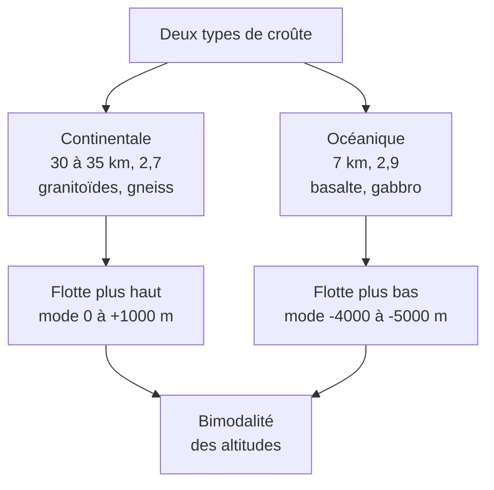

# Synthèse et fiche de révision : Organisation de la Terre en surface

## 1. Fiche de révision

### Les faits à savoir absolument

!!! abstract "Chiffres et valeurs de référence"
    | À connaître | Valeur |
    |---|---|
    | Part des continents / des océans | $\approx 29\ \%$ / $\approx 71\ \%$ |
    | Altitude moyenne des continents | $\approx +840\ \text{m}$ |
    | Profondeur moyenne des océans | $\approx -3800\ \text{m}$ |
    | Mode continental | $0$ à $+1000\ \text{m}$ |
    | Mode océanique | $-4000$ à $-5000\ \text{m}$ |
    | Croûte continentale | $30$ à $35\ \text{km}$ ; $\approx 2{,}7\ \text{g·cm}^{-3}$ ; jusqu'à $\approx 4\ \text{Ga}$ ; granitoïdes, gneiss |
    | Croûte océanique | $\approx 7\ \text{km}$ ; $\approx 2{,}9$ à $3{,}0\ \text{g·cm}^{-3}$ ; $\leq 180$ à $200\ \text{Ma}$ ; basalte, gabbro |
    | Manteau supérieur | péridotite ; $\approx 3{,}3\ \text{g·cm}^{-3}$ |

!!! info "Définitions à savoir rédiger"
    - **Bimodalité des altitudes** : distribution de l'altitude de la surface du globe présentant **deux modes** (continental et océanique), séparés par un creux.
    - **Roche magmatique** : roche formée par refroidissement et cristallisation d'un magma ; **plutonique** (lent, grenue) ou **volcanique** (rapide, microlitique).
    - **Roche métamorphique** : roche transformée **à l'état solide** par hausse de pression et/ou température.
    - **Roche sédimentaire** : roche formée en surface par accumulation de sédiments puis diagenèse.

### Roches : tableau éclair

| Roche | Famille | Texture | Minéraux clés |
|---|---|---|---|
| Granite | magmatique plutonique | grenue | quartz, feldspaths, micas |
| Gneiss | métamorphique | foliée (rubanée) | quartz, feldspaths, micas |
| Basalte | magmatique volcanique | microlitique | plagioclases, pyroxènes, olivine |
| Gabbro | magmatique plutonique | grenue | plagioclases, pyroxènes |

### Schéma bilan

### Pièges à éviter (liste de contrôle)

!!! warning "Avant de rendre ta copie, vérifie que tu n'as pas écrit…"
    - [ ] « Le basalte est plutonique » (il est **volcanique**).
    - [ ] « Le gneiss est magmatique » (il est **métamorphique**).
    - [ ] « Le gneiss est un granite » (il peut en **dériver**, mais sa texture est **foliée**).
    - [ ] « La croûte océanique est plus basse parce qu'elle est mince » (**épaisseur ET densité**).
    - [ ] « La moyenne des altitudes est un mode » (elle tombe dans le **creux**).
    - [ ] « Le plateau continental est océanique » (il est **continental**).
    - [ ] « La croûte océanique est très ancienne » (**$\leq 200\ \text{Ma}$**).
    - [ ] « Le manteau fait partie de la croûte » (la **péridotite** est dans le manteau).
    - [ ] Une description de graphique **sans valeurs chiffrées**.
    - [ ] Une comparaison de barres d'un histogramme à classes **de largeurs différentes**.

### Réflexes pour l'analyse de documents

!!! tip "Méthode générale"
    1. **Lire la consigne** et repérer le verbe (montrer, expliquer, comparer, justifier).
    2. Pour chaque document : **extraire une information chiffrée** utile.
    3. **Croiser** au moins deux documents (c'est ce qu'on évalue).
    4. Mobiliser **une connaissance** (définition, propriété) pour passer de l'observation à l'explication.
    5. **Conclure** en répondant précisément à la question posée.

---

## 2. Comprendre pourquoi, savoir quand l'utiliser, savoir démontrer

### 2.1 Pourquoi la distribution des altitudes est-elle bimodale ?

- **Pourquoi c'est vrai** : la surface du globe est faite de **deux types de croûte** de **densité** et d'**épaisseur** différentes. Chacune se met en équilibre sur le manteau à un niveau qui lui est propre, d'où **deux populations d'altitudes**.
- **Quand l'utiliser** : dès qu'un sujet demande d'expliquer la différence entre continents et océans, ou de relier un relief à la nature de la croûte.
- **Comment le démontrer** : égalité des pressions à la profondeur de compensation, d'où la relation $e = \dfrac{h_c(\rho_m-\rho_c)-h_o(\rho_m-\rho_o)-w(\rho_m-\rho_e)}{\rho_m}$ ; application numérique : $e \approx 1\ \text{km}$.

### 2.2 Pourquoi un gneiss n'est-il pas un granite ?

- **Pourquoi c'est vrai** : même composition minéralogique, mais **histoire différente** : le granite cristallise dans un magma (refroidissement lent), le gneiss se forme **à l'état solide** sous pression et température élevées, ce qui **organise** les minéraux en lits.
- **Quand l'utiliser** : devant deux roches de **même composition**, c'est la **texture** qui permet de trancher, car elle **enregistre les conditions de formation**.
- **Comment le justifier** : observer la texture (grenue ou foliée) en échantillon ou en lame mince ; en déduire l'origine.

### 2.3 Pourquoi basalte et gabbro sont-ils « la même roche » ?

- **Pourquoi** : même magma, **vitesse de refroidissement** différente. Un refroidissement lent laisse le temps aux cristaux de grandir (gabbro) ; un refroidissement rapide donne des microlites et du verre (basalte).
- **Quand l'utiliser** : pour expliquer la **coupe de la croûte océanique** (basaltes en haut, gabbros en bas).

### 2.4 Pourquoi le modèle isostatique est-il utile malgré ses limites ?

- **Pourquoi** : il relie **trois grandeurs mesurables** (épaisseur, densité, altitude) et prédit un bon **ordre de grandeur**.
- **Limites** : croûtes et manteau supposés **homogènes**, équilibre **parfait** (en réalité, des forces dynamiques interviennent, et l'érosion modifie les reliefs).
- **Quand l'utiliser** : pour justifier qu'une montagne a une **racine**, qu'une croûte plus dense est plus basse, ou qu'une croûte amincie peut passer sous le niveau de la mer.

### 2.5 Ce qu'il faut être capable de faire seul(e)

!!! success "Auto-évaluation"
    - [ ] Je sais construire et interpréter un histogramme des altitudes, **avec des valeurs**.
    - [ ] Je sais nommer et justifier granite, gneiss, basalte, gabbro à partir de leur texture et de leur composition.
    - [ ] Je sais donner les cinq caractéristiques des deux croûtes (roches, épaisseur, densité, âge, altitude du mode).
    - [ ] Je sais **expliquer** le lien bimodalité / nature des croûtes avec **épaisseur ET densité**.
    - [ ] Je sais refaire le calcul de $e$ à partir de la formule **donnée**.
    - [ ] Je sais rédiger une réponse d'analyse de documents en quatre temps.

**Suite du cours** : Partie 2, *Détermination des grandes enveloppes de la Terre* (sismologie, régimes de contraintes, discontinuités, modèle PREM).
