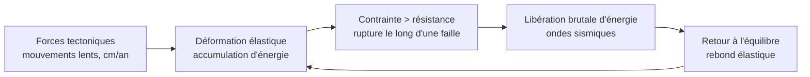
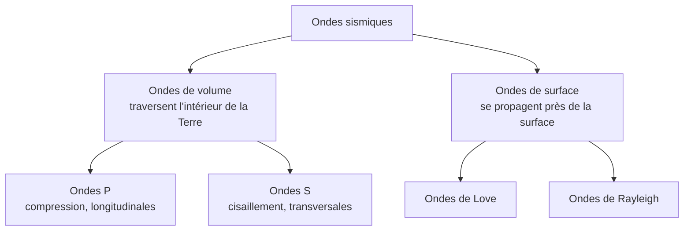
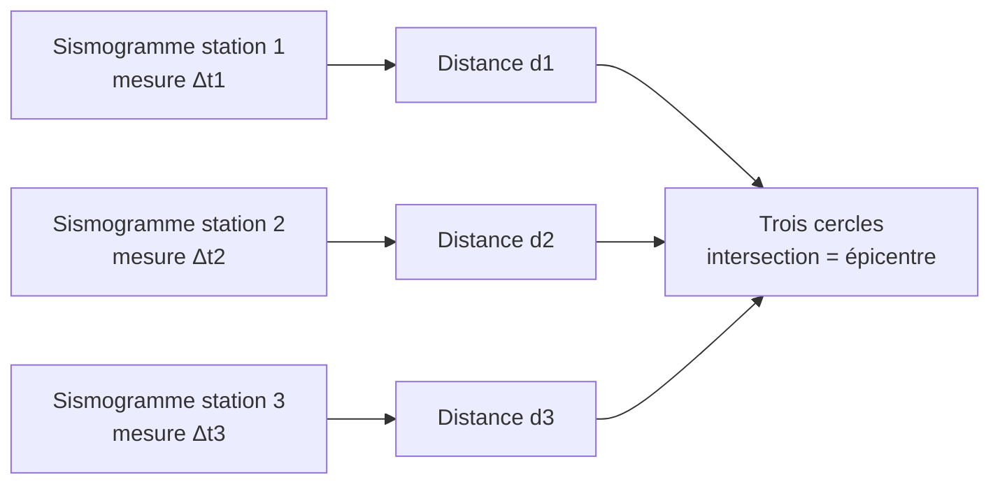

# A. Bases de sismologie

## 1. Formation d'un séisme

### 1.1 Mécanisme : le rebond élastique

!!! info "Définition : séisme"
    Un **séisme** est une **vibration brutale du sol** causée par la **rupture** de roches soumises à des contraintes, le long d'un plan de **faille**, avec libération de l'énergie élastique accumulée.

Les roches de la lithosphère se comportent de manière **cassante** : soumises à des forces tectoniques, elles se **déforment élastiquement** et **accumulent de l'énergie** (comme un ressort comprimé). Quand la contrainte dépasse la **résistance** de la roche, elle **casse** : les deux compartiments glissent brutalement et reviennent vers une position d'équilibre. L'énergie libérée se propage sous forme d'**ondes sismiques**.

!!! info "Vocabulaire"
    - **Faille** : surface de rupture le long de laquelle deux blocs glissent l'un par rapport à l'autre.
    - **Foyer** (ou hypocentre) : point **à l'intérieur de la Terre** où démarre la rupture.
    - **Épicentre** : point de la **surface** à la verticale du foyer.
    - **Profondeur focale** : distance foyer-épicentre ; les foyers vont de la surface à environ $700\ \text{km}$.
    - **Sismogramme** : enregistrement, par un **sismographe**, du mouvement du sol au cours du temps.
    - **Distance épicentrale** : distance entre l'épicentre et la station, exprimée en km ou en degrés d'arc.

### 1.2 Magnitude et intensité

!!! abstract "Deux grandeurs à ne pas confondre"
    | | **Magnitude** | **Intensité** |
    |---|---|---|
    | Mesure | **énergie libérée** au foyer | **effets** observés en un lieu donné |
    | Nombre de valeurs par séisme | **une seule** | **plusieurs** (varie avec la distance, le sol) |
    | Échelle | logarithmique, ouverte (Richter, magnitude de moment) | échelle de degrés (EMS-98 : de I à XII) |
    | Dépend de | la rupture | de la magnitude, de la profondeur, de la distance, de la nature du sol |

!!! abstract "Propriété (échelle logarithmique)"
    Quand la magnitude augmente de **1**, l'**amplitude** des ondes est multipliée par $10$ et l'**énergie libérée** par environ $10^{1{,}5} \approx 32$.

    Entre deux séismes de magnitudes $M_1$ et $M_2$ : $\dfrac{E_2}{E_1} \approx 10^{1{,}5\,(M_2 - M_1)}$.

!!! warning "Points d'attention"
    - Un séisme **n'a pas « une intensité »** mais une magnitude ; l'intensité décrit les dégâts **en un lieu**.
    - Un séisme de magnitude 7 n'est pas « un peu plus fort » qu'un séisme de magnitude 6 : il libère environ **32 fois plus d'énergie**, pas 1,17 fois.

## 2. Les différents types d'ondes sismiques

### 2.1 Vue d'ensemble

### 2.2 Ondes P et ondes S

| | **Ondes P** (primaires) | **Ondes S** (secondaires) |
|---|---|---|
| Mouvement des particules | **parallèle** à la propagation (compression-dilatation) | **perpendiculaire** à la propagation (cisaillement) |
| Nature | **longitudinales** | **transversales** |
| Milieux traversés | **solides et liquides** (et gaz) | **solides uniquement** |
| Vitesse | **plus rapides** | **plus lentes** ($V_S \approx 0{,}55$ à $0{,}6\ V_P$) |
| Arrivée sur le sismogramme | **première** | **seconde** |
| Valeurs courantes | $\approx 6\ \text{km·s}^{-1}$ dans la croûte continentale, $\approx 8\ \text{km·s}^{-1}$ dans le manteau supérieur | $\approx 3{,}5\ \text{km·s}^{-1}$ dans la croûte continentale, $\approx 4{,}5\ \text{km·s}^{-1}$ dans le manteau supérieur |

### 2.3 Pourquoi les ondes S ne traversent-elles pas les liquides ?

!!! abstract "Propriétés : vitesses des ondes de volume"
    Dans un milieu de masse volumique $\rho$, de **module d'incompressibilité** $K$ et de **module de cisaillement** (rigidité) $\mu$ :

    $$V_P = \sqrt{\frac{K + \tfrac{4}{3}\,\mu}{\rho}} \qquad\qquad V_S = \sqrt{\frac{\mu}{\rho}}$$

    - $K$ mesure la **résistance à la compression**, $\mu$ la **résistance au cisaillement**.
    - Un **liquide** n'oppose **aucune résistance au cisaillement** : $\mu = 0$, donc $V_S = 0$ : les ondes S **ne se propagent pas**.
    - Comme $K + \tfrac43\mu > \mu$, on a toujours $V_P > V_S$ : les ondes P arrivent **toujours avant**.

!!! tip "Comment s'en servir"
    **Absence d'ondes S dans une zone** $\Rightarrow$ cette zone est **liquide** (ou très proche de la fusion). C'est l'argument qui prouvera l'existence du noyau externe liquide (partie C).

### 2.4 Ondes de surface

Les ondes de **Love** (cisaillement horizontal) et de **Rayleigh** (mouvement elliptique) se propagent **près de la surface**, sont **plus lentes** que les ondes de volume, mais **plus amples** : ce sont elles qui causent l'essentiel des **dégâts**. Elles ne servent pas à explorer le noyau.

## 3. Localiser un séisme

### 3.1 Principe : le décalage S−P

Les ondes P et S partent en même temps du foyer mais n'ont pas la même vitesse. Plus la station est **loin**, plus l'**écart de temps** entre les arrivées des P et des S est **grand**.

!!! abstract "Relation distance - décalage S−P"
    Pour une distance $d$ parcourue à vitesses constantes $V_P$ et $V_S$ :

    $$\Delta t = t_S - t_P = d\left(\frac{1}{V_S} - \frac{1}{V_P}\right) \quad\Longrightarrow\quad d = \Delta t\,\frac{V_P V_S}{V_P - V_S}$$

    Pour $V_P = 6\ \text{km·s}^{-1}$ et $V_S = 3{,}5\ \text{km·s}^{-1}$ : $d \approx 8{,}4\ \Delta t$ (avec $d$ en km, $\Delta t$ en s).

### 3.2 Triangulation

Une seule station donne seulement une **distance** : l'épicentre est sur un **cercle** de rayon $d$ centré sur la station. Il faut **au moins trois stations** : l'épicentre est à l'**intersection** des trois cercles.

### 3.3 Méthode

!!! tip "Méthode : localiser un épicentre"
    1. Sur chaque sismogramme, **repérer les arrivées P et S** et mesurer $\Delta t = t_S - t_P$.
    2. Calculer la **distance** $d = \Delta t \times \dfrac{V_P V_S}{V_P - V_S}$ (ou la lire sur une courbe de référence).
    3. Tracer, à l'**échelle**, un cercle de rayon $d$ autour de chaque station.
    4. L'**épicentre** est le point commun aux trois cercles ; l'**heure origine** se déduit de $t_P - d/V_P$.

### 3.4 Exemple corrigé

!!! example "Exemple"
    Trois stations mesurent des décalages S−P de $25\ \text{s}$, $40\ \text{s}$ et $55\ \text{s}$. On prend $V_P = 6\ \text{km·s}^{-1}$ et $V_S = 3{,}5\ \text{km·s}^{-1}$. Calculer les distances épicentrales et donner l'heure origine du séisme pour la première station sachant que les ondes P y arrivent à $12\ \text{h}\ 04\ \text{min}\ 30\ \text{s}$.

??? success "Corrigé"
    Facteur de proportionnalité : $\dfrac{V_P V_S}{V_P-V_S} = \dfrac{6 \times 3{,}5}{2{,}5} = 8{,}4\ \text{km·s}^{-1}$.

    - Station 1 : $d_1 = 8{,}4 \times 25 = 210\ \text{km}$.
    - Station 2 : $d_2 = 8{,}4 \times 40 = 336\ \text{km}$.
    - Station 3 : $d_3 = 8{,}4 \times 55 = 462\ \text{km}$.

    Heure origine : temps de trajet des ondes P jusqu'à la station 1 $= \dfrac{210}{6} = 35\ \text{s}$. L'heure origine est donc $12\ \text{h}\ 04\ \text{min}\ 30\ \text{s} - 35\ \text{s} = 12\ \text{h}\ 03\ \text{min}\ 55\ \text{s}$.

    !!! warning "Piège évité"
        Le **décalage S−P** n'est **pas** le temps de trajet des ondes P. Le temps de trajet suppose de connaître l'**heure origine**, qui est justement inconnue : c'est le décalage qui permet de la retrouver.

## 4. Points d'attention de cette section

!!! warning "Erreurs fréquentes"
    - Écrire que les ondes S sont « bloquées » : on dit qu'elles **ne se propagent pas** dans un liquide, car $\mu = 0$.
    - Dire que les ondes P sont « plus rapides **parce qu'elles sont longitudinales** » : la vraie raison est la formule $V_P > V_S$, qui découle de $K + \tfrac{4}{3}\mu > \mu$.
    - Confondre **foyer** (en profondeur) et **épicentre** (en surface).
    - Dire que la magnitude se mesure « en degrés » : l'échelle de Richter n'a pas d'unité, les degrés concernent l'intensité EMS-98 (chiffres romains).
    - Triangulation avec **deux** stations : on obtient deux points d'intersection, donc une **ambiguïté**.
