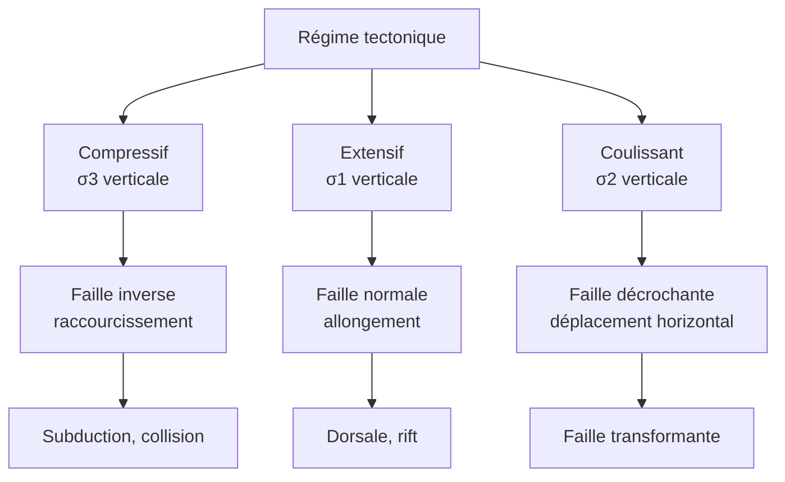

# B. Lien entre forces et contexte géodynamique

## 1. Contraintes et déformations

!!! info "Définitions"
    - **Contrainte** : force exercée par unité de surface, $\sigma = \dfrac{F}{S}$, en pascals (Pa) ; elle peut être de **compression**, d'**extension** ou de **cisaillement**.
    - **Déformation** : changement de forme ou de volume d'une roche sous l'effet d'une contrainte.
    - **Comportement cassant** : la roche **se rompt** (faille, séisme), typique de la lithosphère superficielle.
    - **Comportement ductile** : la roche **flue** sans se rompre (plis, étirements), typique des roches chaudes en profondeur.
    - **Régime tectonique** : type de contrainte dominant dans une région (compressif, extensif ou coulissant).

!!! abstract "Les trois contraintes principales"
    En un point du globe, les contraintes s'organisent selon trois directions perpendiculaires : $\sigma_1 \geq \sigma_2 \geq \sigma_3$.

    - $\sigma_1$ : contrainte **maximale** (compression la plus forte).
    - $\sigma_3$ : contrainte **minimale** (la plus faible ; extension).

    La direction **verticale** est celle du **poids des roches** ; ce qui change d'un régime à l'autre, c'est **laquelle des trois contraintes est verticale**.

## 2. Les trois régimes

### 2.1 Régime compressif

!!! abstract "Régime compressif"
    - **Forces** : deux blocs sont **poussés l'un vers l'autre** ($\sigma_1$ horizontale, $\sigma_3$ verticale).
    - **Déformation** : **raccourcissement horizontal**, **épaississement vertical**.
    - **Failles** : **failles inverses** (le compartiment supérieur **monte** par rapport à l'inférieur) et **chevauchements** ; **plis**.
    - **Contextes** : **subduction**, **collision continentale** (Alpes, Himalaya).

### 2.2 Régime extensif

!!! abstract "Régime extensif"
    - **Forces** : deux blocs sont **tirés en sens opposés** ($\sigma_1$ verticale, $\sigma_3$ horizontale).
    - **Déformation** : **allongement horizontal**, **amincissement** de la lithosphère.
    - **Failles** : **failles normales** (le compartiment supérieur **descend**), formant des fossés d'effondrement (*grabens*).
    - **Contextes** : **dorsales océaniques**, **rifts continentaux** (rift est-africain), **marges** en cours d'ouverture.

### 2.3 Régime coulissant (décrochant)

!!! abstract "Régime coulissant"
    - **Forces** : deux blocs **glissent horizontalement** l'un contre l'autre ($\sigma_2$ verticale, $\sigma_1$ et $\sigma_3$ horizontales).
    - **Déformation** : déplacement **horizontal** le long d'un plan vertical.
    - **Failles** : **failles décrochantes** (*dextres* ou *sénestres* selon le sens de déplacement relatif).
    - **Contextes** : **failles transformantes** (San Andreas, faille nord-anatolienne), failles qui décalent les segments de dorsale.

### 2.4 Tableau de synthèse

| Régime | Forces | Sens du mouvement | Faille | Épaisseur de la lithosphère | Contexte |
|---|---|---|---|---|---|
| **Compressif** | convergentes | blocs rapprochés | inverse, chevauchement | **épaissie** | subduction, collision |
| **Extensif** | divergentes | blocs écartés | normale | **amincie** | dorsale, rift |
| **Coulissant** | parallèles de sens opposés | blocs glissant côte à côte | décrochante | inchangée | faille transformante |

## 3. Reconnaître un régime sur le terrain ou un document

!!! tip "Méthode : identifier le type de faille et le régime"
    1. **Repérer le plan de faille** (ligne de rupture) et les deux compartiments.
    2. Regarder le **mouvement relatif** du **compartiment supérieur** (celui qui est au-dessus du plan incliné) :
        - il **descend** $\Rightarrow$ faille **normale** $\Rightarrow$ **extension** ;
        - il **monte** $\Rightarrow$ faille **inverse** $\Rightarrow$ **compression** ;
        - mouvement **horizontal** $\Rightarrow$ faille **décrochante** $\Rightarrow$ **coulissement**.
    3. **Conclure** sur le régime, puis sur le **contexte géodynamique** probable, en s'appuyant sur le lieu.

!!! example "Exemple corrigé"
    Sur un affleurement, des couches sédimentaires horizontales sont coupées par une faille inclinée. Le compartiment situé **au-dessus** du plan de faille s'est **abaissé** de $2\ \text{m}$ par rapport à l'autre. Quel est le régime ?

??? success "Corrigé"
    Le compartiment supérieur **descend** : c'est une **faille normale**. Elle traduit un **allongement horizontal**, donc un **régime extensif**. Ce type de structure se rencontre dans un contexte de **rift** ou de **dorsale**.

## 4. Lien avec les séismes

Les séismes sont **répartis selon le contexte** :

- **dorsales** : séismes **peu profonds** (quelques kilomètres), de **magnitude modérée** ;
- **failles transformantes** : séismes **superficiels**, parfois très **violents** (San Andreas) ;
- **subductions** : foyers de **$0$ à environ $700\ \text{km}$**, alignés sur un **plan incliné** (plan de Wadati-Benioff) qui **dessine** la plaque plongeante ;
- **collisions** : séismes **superficiels à intermédiaires**, nombreux et importants.

!!! warning "Points d'attention"
    - **Ne pas confondre** « faille inverse » avec « faille décrochante » : le sens du mouvement relatif (**vertical** ou **horizontal**) est le critère.
    - Le **régime** est une propriété du **champ de contraintes** ; la **faille** en est la **trace** observable.
    - Une **faille normale** n'est pas « normale » parce qu'elle est fréquente : le terme vient de l'**effondrement** du compartiment supérieur.
    - Un **chevauchement** est une faille **inverse à faible pendage** : il **empile** des unités, d'où un raccourcissement important.
    - Les **foyers profonds** ($> 300\ \text{km}$) n'existent **qu'en subduction** : c'est un indice de la présence d'une plaque plongeante.
