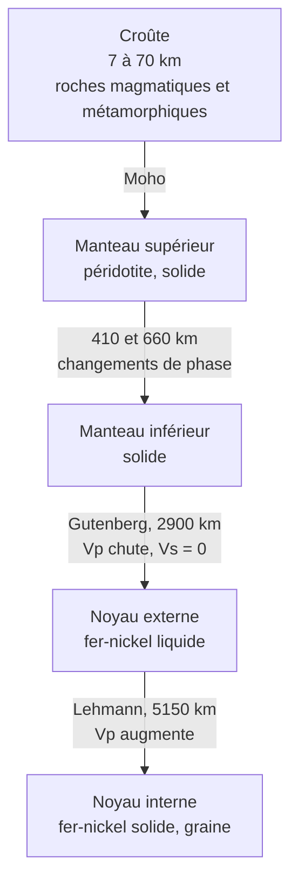

# C. Mise en évidence des discontinuités sismiques

## 1. Principe : les ondes comme sondes

!!! info "Définitions"
    - **Discontinuité sismique** : surface (ou zone mince) à la traversée de laquelle la **vitesse** des ondes sismiques change **brusquement** ($V_P$ et/ou $V_S$).
    - **Réfraction** : changement de direction d'une onde qui passe d'un milieu à un autre où sa vitesse est différente.
    - **Réflexion** : « rebond » d'une partie de l'onde sur l'interface.
    - **Zone d'ombre** : région de la surface où l'on **n'enregistre pas** un certain type d'onde provenant d'un séisme.

!!! abstract "Loi de Snell-Descartes (version sismique)"
    À l'interface de deux milieux où les ondes ont les vitesses $V_1$ et $V_2$, avec $i_1$ et $i_2$ les angles par rapport à la **normale** à l'interface :

    $$\frac{\sin i_1}{V_1} = \frac{\sin i_2}{V_2}$$

    - Si $V_2 > V_1$ : le rayon **s'écarte de la normale** ($i_2 > i_1$).
    - Si $V_2 < V_1$ : le rayon **se rapproche de la normale**.
    - Au-delà d'un **angle critique** $i_c$ tel que $\sin i_c = \dfrac{V_1}{V_2}$ (avec $V_2 > V_1$), il y a **onde réfractée rasante** : l'onde se propage le long de l'interface.

!!! abstract "Deux types de variation de vitesse"
    - **Variation continue** de la vitesse avec la profondeur : trajectoires **courbes** (rayons qui se courbent progressivement vers la surface).
    - **Variation brusque** : **réfraction et réflexion marquées**, trajectoires **brisées** ; c'est la signature d'une **discontinuité**, c'est-à-dire d'un **changement de nature ou d'état** du matériau.

## 2. La discontinuité de Mohorovičić (Moho)

### 2.1 Observation (Mohorovičić, 1909)

Lors d'un séisme proche en Croatie, Andrija Mohorovičić observe, pour les stations situées à **plus de $\approx 200\ \text{km}$**, **deux arrivées d'ondes P** au lieu d'une : une onde **directe** (arrivant en premier à courte distance) et une onde qui a **plongé** puis est **revenue** après un trajet plus profond mais plus **rapide**.

### 2.2 Interprétation

!!! abstract "Résultat : le Moho"
    La **discontinuité de Mohorovičić (Moho)** sépare la **croûte** du **manteau** :

    - **Profondeur** : environ $30$ à $35\ \text{km}$ sous les continents (jusqu'à $70\ \text{km}$ sous les chaînes), environ $7\ \text{km}$ sous les océans.
    - **Saut de vitesse** : $V_P$ passe d'environ $6$ à $7\ \text{km·s}^{-1}$ dans la croûte à environ $8\ \text{km·s}^{-1}$ dans le manteau.
    - **Interprétation** : **changement de nature** des roches, des granitoïdes ou basaltes et gabbros de la croûte vers la **péridotite** du manteau.

### 2.3 Calcul de la profondeur du Moho (approfondissement)

!!! note "Niveau du programme"
    Ce calcul n'est **pas exigible** en 1ère, mais il montre **comment** on mesure la profondeur d'une discontinuité et il t'aidera à bien comprendre les sismogrammes.

Soit une croûte d'épaisseur $h$ (vitesse $V_1$) sur un manteau (vitesse $V_2 > V_1$). À la distance $x$ de l'épicentre, on enregistre :

- l'onde **directe** : $t_d = \dfrac{x}{V_1}$ ;
- l'onde **réfractée** sur le Moho : $t_r = \dfrac{x}{V_2} + \dfrac{2h\sqrt{V_2^2 - V_1^2}}{V_1 V_2}$.

À la **distance critique** $x_c$, les deux temps sont **égaux** (au-delà, l'onde réfractée, plus rapide, arrive **avant** la directe) :

$$x_c = 2h\sqrt{\frac{V_2 + V_1}{V_2 - V_1}} \quad\Longrightarrow\quad h = \frac{x_c}{2}\sqrt{\frac{V_2 - V_1}{V_2 + V_1}}$$

!!! example "Exemple corrigé"
    Avec $V_1 = 6{,}0\ \text{km·s}^{-1}$, $V_2 = 8{,}0\ \text{km·s}^{-1}$ et $x_c = 170\ \text{km}$, calculer $h$.

??? success "Corrigé"
    $h = \dfrac{170}{2}\sqrt{\dfrac{8-6}{8+6}} = 85 \times \sqrt{\dfrac{1}{7}} = \dfrac{85}{2{,}6458} \approx 32\ \text{km}$.

    La profondeur du Moho est donc d'environ **$32\ \text{km}$**, valeur typique d'une croûte continentale.

## 3. La discontinuité de Gutenberg

### 3.1 Observations

Sur un globe, on place des stations à des **distances angulaires** $\Delta$ croissantes de l'épicentre (angle au centre de la Terre).

!!! abstract "Observations"
    - **Ondes S** : enregistrées **jusqu'à $\Delta \approx 103^\circ$**, **absentes au-delà**.
    - **Ondes P** : enregistrées jusqu'à $\Delta \approx 103^\circ$, **absentes** entre **$103^\circ$ et $142^\circ$** (**zone d'ombre des ondes P**), puis **réapparaissent** au-delà de $142^\circ$, avec un **retard**.

### 3.2 Interprétation

!!! abstract "Résultat : la discontinuité de Gutenberg (≈ 2900 km)"
    - Un **changement brusque de vitesse** à $\approx 2900\ \text{km}$ de profondeur **courbe** et **réfracte** fortement les ondes P : c'est ce qui crée la **zone d'ombre** entre $103^\circ$ et $142^\circ$. Les rayons qui **entrent** dans le noyau sont **fortement déviés** vers l'axe, et émergent au-delà de $142^\circ$.
    - La **disparition des ondes S** au-delà de $103^\circ$ montre qu'elles **ne traversent pas** le noyau externe : $V_S = 0$ donc $\mu = 0$, ce qui signifie que le **noyau externe est liquide**.
    - À cette profondeur, $V_P$ **chute** brutalement (d'environ $13{,}7$ à $8\ \text{km·s}^{-1}$) : la nature et l'état du matériau changent.

!!! tip "Raisonnement à savoir refaire"
    **Constat** : pas d'ondes S au-delà de $103^\circ$. **Propriété** : les ondes S ne se propagent pas dans un liquide. **Conclusion** : il existe, à partir de $2900\ \text{km}$, une enveloppe **liquide** : le **noyau externe**.

## 4. La discontinuité de Lehmann

### 4.1 Observation (Inge Lehmann, 1936)

Dans la **zone d'ombre** des ondes P, on enregistre pourtant de **faibles ondes P**. Elles ne peuvent pas être des ondes diffractées simples : leur arrivée est trop nette.

### 4.2 Interprétation

!!! abstract "Résultat : la discontinuité de Lehmann (≈ 5150 km)"
    Une **augmentation brusque de $V_P$** à $\approx 5150\ \text{km}$ **réfléchit** une partie des ondes P vers la zone d'ombre. On en déduit l'existence d'une **graine** (**noyau interne**) **solide**, au centre d'un noyau externe liquide. Des études postérieures (ondes S converties, modes propres) confirment sa **rigidité** : le noyau interne est **solide**, malgré sa température très élevée, à cause de la **pression colossale**.

## 5. Autres variations de vitesse

!!! info "À connaître"
    - **Zone à faible vitesse** (vers $100$ à $200\ \text{km}$ de profondeur) : légère **diminution** des vitesses, surtout des ondes S ; elle est interprétée comme un matériau **moins rigide**, proche de sa température de fusion, qui correspond à l'**asthénosphère** (voir le chapitre 2).
    - **Discontinuités à $410$ et $660\ \text{km}$** : changements de **structure cristalline** de l'olivine et de ses variants, sous l'effet de la **pression**, **sans changement de composition chimique** d'ensemble.

## 6. Schéma bilan des enveloppes

| Enveloppe | Profondeur | État | Composition |
|---|---|---|---|
| **Croûte** | $0$ à $7$-$70\ \text{km}$ | solide | granitoïdes ; basaltes et gabbros |
| **Manteau** | jusqu'à $2900\ \text{km}$ | solide (flue très lentement) | **péridotite** (olivine, pyroxènes) |
| **Noyau externe** | $2900$ à $5150\ \text{km}$ | **liquide** | alliage de **fer et de nickel** + éléments légers |
| **Noyau interne** | $5150$ à $6371\ \text{km}$ | **solide** | alliage de **fer et de nickel** |

## 7. Points d'attention de cette section

!!! warning "Erreurs fréquentes"
    - **Moho** (croûte/manteau, discontinuité de **nature chimique**) ne correspond **pas** à la limite **lithosphère/asthénosphère** (limite **mécanique**, vers $100$ km).
    - Écrire que « les ondes S sont absorbées » ou « arrêtées » : elles **ne se propagent pas** dans un liquide ($\mu = 0$).
    - Dire que **le manteau est liquide** parce qu'il est « chaud » : les ondes S le traversent, il est **solide** (mais ductile à très long terme : **convection**).
    - Confondre la **zone d'ombre des ondes P** ($103^\circ$ à $142^\circ$) et l'**absence des ondes S** (au-delà de $103^\circ$).
    - Écrire que la zone d'ombre est due à l'**absorption** des ondes : elle est due à la **réfraction**.
    - Oublier que l'**état solide du noyau interne** vient de la **pression**, pas d'une température plus basse.
    - Déduire la **composition** des enveloppes **uniquement** des ondes : la vitesse dépend de $K$, $\mu$ et $\rho$ à la fois ; il faut croiser avec **météorites**, **densité globale** et **roches du manteau** remontées (xénolithes, ophiolites).
