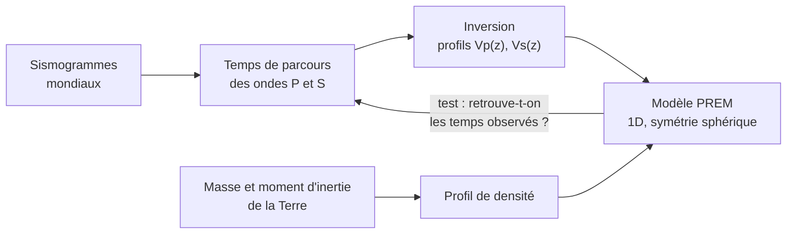
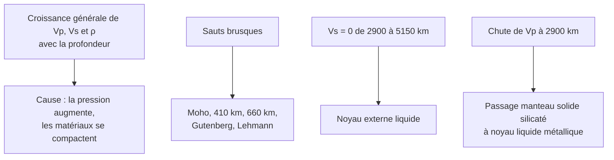

# D. Le modèle PREM

## 1. Définition et construction

!!! info "Définition : le modèle PREM"
    Le **modèle PREM** (*Preliminary Reference Earth Model*, Dziewonski et Anderson, 1981) est un **modèle de référence à une dimension** : il donne, **en fonction de la seule profondeur**, la **vitesse des ondes P et S**, la **masse volumique** et la **pression** à l'intérieur de la Terre, en supposant une **Terre à symétrie sphérique** (une même valeur à une profondeur donnée, quel que soit le lieu).

!!! abstract "Comment est-il construit ?"
    1. On **collecte** un très grand nombre de **sismogrammes** (milliers de séismes, réseaux mondiaux de stations).
    2. On en déduit les **temps de parcours** des ondes P et S selon la distance épicentrale.
    3. On **inverse** ces données pour obtenir $V_P(z)$ et $V_S(z)$, en ajustant aussi les **oscillations libres** de la Terre (après les très gros séismes, la Terre « sonne » comme une cloche).
    4. On **contraint** la masse volumique par la **masse** ($\approx 5{,}97 \times 10^{24}\ \text{kg}$) et le **moment d'inertie** de la Terre.
    5. On **vérifie** la cohérence : le modèle doit **reproduire** les temps de parcours observés.

## 2. Lecture du modèle

### 2.1 Valeurs approchées

| Enveloppe | Profondeur (km) | $V_P$ (km·s⁻¹) | $V_S$ (km·s⁻¹) | $\rho$ (g·cm⁻³) |
|---|---|---|---|---|
| Croûte | $0$ à $\approx 30$ | $\approx 6$ à $7$ | $\approx 3{,}5$ | $\approx 2{,}7$ à $2{,}9$ |
| Manteau supérieur | $30$ à $660$ | $\approx 8$ à $11$ | $\approx 4{,}5$ à $6$ | $\approx 3{,}4$ à $4$ |
| Manteau inférieur | $660$ à $2900$ | $\approx 11$ à $13{,}7$ | $\approx 6$ à $7{,}3$ | $\approx 4{,}4$ à $5{,}6$ |
| Noyau externe | $2900$ à $5150$ | $\approx 8$ à $10{,}3$ | **$0$** | $\approx 9{,}9$ à $12{,}2$ |
| Noyau interne | $5150$ à $6371$ | $\approx 11$ | $\approx 3{,}5$ | $\approx 12{,}8$ à $13{,}1$ |

!!! warning "Remarque"
    Ces valeurs sont des **ordres de grandeur** à retenir pour raisonner. En contrôle, les valeurs sont **toujours fournies** dans les documents ; ce qui compte, c'est la **lecture** (sauts, valeurs nulles, tendances).

### 2.2 Ce que montrent les courbes

!!! abstract "Résultats à retenir"
    - $V_P$, $V_S$ et $\rho$ **augmentent globalement** avec la profondeur (pression croissante), sauf **aux discontinuités** et dans la **zone à faible vitesse**.
    - La **masse volumique** a un **saut majeur** à $2900\ \text{km}$ : de $\approx 5{,}6$ à $\approx 9{,}9\ \text{g·cm}^{-3}$. Cela s'explique par un **changement de composition** : des **silicates** (manteau) vers un **alliage de fer et de nickel** (noyau).
    - **Densité moyenne de la Terre** $\approx 5{,}5\ \text{g·cm}^{-3}$ **supérieure** à celle des roches de surface ($\approx 2{,}7$ à $3$) : l'intérieur est donc **beaucoup plus dense**, donc **métallique** au centre.

### 2.3 Pression et température au centre

- **Pression** : environ $136\ \text{GPa}$ à la base du manteau et environ $364\ \text{GPa}$ au centre (soit plus de **$3{,}6$ millions** de fois la pression atmosphérique).
- **Température** : de l'ordre de $5000\ \text{à}\ 6000\ ^\circ\text{C}$ au centre, mais le noyau interne est **solide** car la **pression élevée** élève la **température de fusion** du fer.

## 3. Exploiter les modules : un calcul rigoureux

!!! tip "Méthode : passer des vitesses aux propriétés mécaniques"
    À partir de $V_P$, $V_S$ et $\rho$, on remonte à la **rigidité** et à l'**incompressibilité** :

    $$\mu = \rho\, V_S^2 \qquad\qquad K = \rho\left(V_P^2 - \tfrac{4}{3}\,V_S^2\right)$$

    Attention aux **unités** : $\rho$ en $\text{kg·m}^{-3}$ et $V$ en $\text{m·s}^{-1}$ donnent un résultat en **pascals**.

!!! example "Exemple corrigé"
    Dans le manteau supérieur, à environ $100\ \text{km}$ de profondeur : $\rho = 3{,}38\ \text{g·cm}^{-3}$, $V_P = 8{,}1\ \text{km·s}^{-1}$, $V_S = 4{,}5\ \text{km·s}^{-1}$. Calculer $\mu$ et $K$.

??? success "Corrigé"
    Conversions : $\rho = 3380\ \text{kg·m}^{-3}$, $V_P = 8100\ \text{m·s}^{-1}$, $V_S = 4500\ \text{m·s}^{-1}$.

    $\mu = 3380 \times 4500^2 = 3380 \times 2{,}025\times10^{7} \approx 6{,}8\times10^{10}\ \text{Pa} \approx 68\ \text{GPa}$.

    $K = 3380\left(8100^2 - \tfrac43\times4500^2\right) = 3380\,(6{,}561\times10^{7} - 2{,}70\times10^{7}) = 3380\times 3{,}861\times10^{7} \approx 1{,}3\times10^{11}\ \text{Pa} \approx 130\ \text{GPa}$.

    Le milieu a une **rigidité non nulle** ($\mu \approx 68\ \text{GPa}$) : c'est un **solide**.

## 4. Apports et limites du modèle

!!! abstract "Apports"
    - Un **cadre de référence** pour **interpréter** de nouvelles données : on compare une mesure au PREM pour détecter des **anomalies** (partie 3).
    - Il fixe la **structure en enveloppes concentriques** : croûte, manteau, noyau externe, noyau interne.

!!! warning "Limites"
    - Il est **1D** : il **gomme les variations latérales** (une dorsale et un craton n'ont pas les mêmes vitesses à même profondeur).
    - Il donne **des vitesses et des densités**, **pas la composition** : celle-ci exige d'autres données (météorites, roches du manteau, expériences à haute pression).
    - Il ne dit **rien de la dynamique** : le manteau **convecte**, ce que révèle la **tomographie**.
    - C'est un **modèle** : une **représentation simplifiée** qu'on **améliore**. Le terme « *preliminary* » rappelle que c'est une **première référence**, toujours affinée.

## 5. Points d'attention de cette section

!!! warning "Erreurs fréquentes"
    - Dire que le PREM est « une mesure directe de l'intérieur de la Terre » : c'est un **modèle déduit** de mesures **indirectes** en surface.
    - Penser que **vitesse élevée = densité élevée**, **toujours** : c'est vrai globalement avec la profondeur, mais $V_P$ **chute** à $2900\ \text{km}$ alors que $\rho$ **augmente**. La vitesse dépend de $K$, $\mu$ et $\rho$ **ensemble**.
    - Oublier les **unités** dans le calcul de $\mu$ et $K$ (g·cm⁻³ et km·s⁻¹ à convertir).
    - Confondre « modèle 1D » et « Terre sans variation » : le modèle moyenne ces variations, il ne les **nie** pas.
