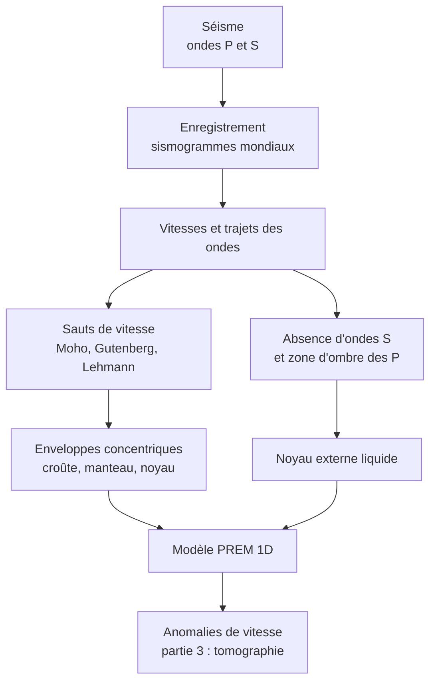

# Synthèse et fiche de révision : Détermination des grandes enveloppes de la Terre

## 1. Fiche de révision

### Les faits à savoir absolument

!!! abstract "Chiffres et valeurs de référence"
    | À connaître | Valeur |
    |---|---|
    | Rayon de la Terre | $\approx 6371\ \text{km}$ |
    | Profondeur du **Moho** | $\approx 30$ à $35\ \text{km}$ (continents), $\approx 7\ \text{km}$ (océans) |
    | Discontinuité de **Gutenberg** | $\approx 2900\ \text{km}$ (manteau / noyau externe) |
    | Discontinuité de **Lehmann** | $\approx 5150\ \text{km}$ (noyau externe / noyau interne) |
    | Zone d'ombre des ondes P | de $103^\circ$ à $142^\circ$ |
    | Ondes S | absentes au-delà de $103^\circ$ |
    | $V_P$ / $V_S$ croûte | $\approx 6$ / $3{,}5\ \text{km·s}^{-1}$ |
    | $V_P$ / $V_S$ manteau supérieur | $\approx 8$ / $4{,}5\ \text{km·s}^{-1}$ |
    | Noyau externe | liquide, $V_S = 0$ |
    | Foyers sismiques | de $0$ à $\approx 700\ \text{km}$ |
    | Magnitude $+1$ | amplitude $\times10$, énergie $\times\approx 32$ |

!!! info "Définitions à savoir rédiger"
    - **Séisme** : vibration brutale du sol due à la rupture de roches le long d'une faille, libérant l'énergie élastique accumulée.
    - **Foyer / épicentre** : point de départ de la rupture en profondeur / point de la surface à sa verticale.
    - **Ondes P** : ondes de compression, longitudinales, les plus rapides, traversent solides et liquides.
    - **Ondes S** : ondes de cisaillement, transversales, plus lentes, ne se propagent **que dans les solides**.
    - **Discontinuité sismique** : surface où la vitesse des ondes change brusquement.
    - **Modèle PREM** : modèle de référence 1D de la vitesse des ondes, de la masse volumique et de la pression en fonction de la profondeur.

### Propriétés à savoir utiliser

!!! abstract "Les trois formules du chapitre"
    $$V_P = \sqrt{\frac{K + \frac43\mu}{\rho}} \qquad V_S = \sqrt{\frac{\mu}{\rho}} \qquad d = \Delta t_{S-P}\,\frac{V_PV_S}{V_P-V_S}$$

    et la loi de Snell-Descartes : $\dfrac{\sin i_1}{V_1} = \dfrac{\sin i_2}{V_2}$.

### Régimes tectoniques : tableau éclair

| Régime | Faille | Mouvement | Contexte |
|---|---|---|---|
| Compressif | inverse, chevauchement | raccourcissement | subduction, collision |
| Extensif | normale | allongement | dorsale, rift |
| Coulissant | décrochante | déplacement horizontal | faille transformante |

### Schéma bilan

### Pièges à éviter (liste de contrôle)

!!! warning "Avant de rendre ta copie, vérifie que tu n'as pas écrit…"
    - [ ] « Les ondes S sont absorbées ou bloquées » (elles **ne se propagent pas** dans un liquide).
    - [ ] « La zone d'ombre est due à l'absorption » (elle est due à la **réfraction**).
    - [ ] « Le Moho est la limite lithosphère-asthénosphère » (c'est la limite **croûte-manteau**).
    - [ ] « Le manteau est liquide » (il est **solide**).
    - [ ] « Le noyau interne est solide car il est plus froid » (c'est la **pression**).
    - [ ] « Le PREM est une mesure directe » (c'est un **modèle déduit**).
    - [ ] Une confusion entre **magnitude** (énergie, un nombre) et **intensité** (effets, chiffres romains).
    - [ ] « Un degré de plus de magnitude = un peu plus d'énergie » (**$\times 32$**).
    - [ ] Une confusion faille **inverse** / **normale** / **décrochante**.
    - [ ] Une réponse sans **valeur chiffrée** tirée du document.

### Réflexes pour l'analyse de documents

!!! tip "Méthode"
    1. **Citer** les valeurs clés (distance angulaire, vitesse, profondeur).
    2. **Interpréter** chaque observation avec une **propriété** (« $\mu = 0$ donc $V_S = 0$ »).
    3. **Croiser** les documents, puis **conclure** en répondant à la question.
    4. Pour un calcul : **formule, unités converties, application, résultat avec unité**.

---

## 2. Comprendre pourquoi, savoir quand l'utiliser, savoir démontrer

### 2.1 Pourquoi le noyau externe est-il liquide ?

- **Pourquoi c'est vrai** : les ondes S, de cisaillement, exigent un milieu qui **résiste au cisaillement** ($\mu \neq 0$). Elles disparaissent après $103^\circ$ : le matériau traversé a $\mu = 0$.
- **Quand l'utiliser** : à chaque fois qu'un document montre une **absence d'ondes S** dans une zone.
- **Comment le démontrer** : $V_S = \sqrt{\mu/\rho}$ donc $\mu = 0 \Rightarrow V_S = 0$ ; absence de S $\Rightarrow \mu = 0 \Rightarrow$ liquide. Vérification dans le PREM : $\mu = \rho\,V_S^2 = 0$ entre $2900$ et $5150\ \text{km}$.

### 2.2 Pourquoi $V_P$ chute-t-elle à $2900\ \text{km}$ alors que la densité augmente ?

- **Pourquoi** : $V_P^2 = \dfrac{K + \frac43\mu}{\rho}$. À $2900\ \text{km}$, le terme $\frac43\mu$ **disparaît** (liquide) et $\rho$ **double** ; $K$ reste proche. Le numérateur baisse, le dénominateur monte.
- **Quand l'utiliser** : pour éviter l'erreur « vitesse élevée = milieu plus dense ».
- **Démonstration** : calcul de $K$ et $\mu$ au-dessus et en dessous de la discontinuité (exercice 8).

### 2.3 Pourquoi la zone d'ombre des ondes P existe-t-elle ?

- **Pourquoi** : à $2900\ \text{km}$, $V_P$ diminue brutalement ; la loi de Snell-Descartes ($V_2 < V_1 \Rightarrow i_2 < i_1$) **rapproche** les rayons de la normale. Les rayons entrant dans le noyau émergent donc **au-delà de $142^\circ$**, laissant vide la région de $103^\circ$ à $142^\circ$.
- **Quand l'utiliser** : devant un document présentant des stations avec ou sans enregistrement des ondes.
- **Comment le démontrer** : application de la loi de Snell-Descartes (exercice 5).

### 2.4 Pourquoi y a-t-il une graine solide ?

- **Pourquoi** : des ondes P **réfléchies** dans la zone d'ombre indiquent un **saut de vitesse** à $5150\ \text{km}$. Le fer, liquide à pression modérée, devient **solide** sous une pression d'environ $330\ \text{GPa}$ : la pression élève la température de fusion.
- **Quand l'utiliser** : pour expliquer qu'un matériau très chaud puisse être solide.

### 2.5 Pourquoi les régimes tectoniques déterminent-ils le type de faille ?

- **Pourquoi** : la roche casse selon la **direction de la contrainte maximale** ($\sigma_1$). Si $\sigma_1$ est **horizontale** (compression), le compartiment supérieur **monte** (faille inverse). Si $\sigma_1$ est **verticale** (extension horizontale), il **descend** (faille normale). Si $\sigma_2$ est verticale, il y a **glissement horizontal**.
- **Quand l'utiliser** : pour déduire le contexte à partir d'une faille observée, et inversement.

### 2.6 Ce qu'il faut être capable de faire seul(e)

!!! success "Auto-évaluation"
    - [ ] Je sais décrire le **mécanisme d'un séisme** et distinguer foyer, épicentre, magnitude, intensité.
    - [ ] Je sais **comparer** ondes P et S (nature, milieux, vitesse) et justifier avec $V_P$ et $V_S$.
    - [ ] Je sais **localiser** un épicentre (décalage S−P, triangulation).
    - [ ] Je sais **reconnaître** un régime et une faille, et citer un contexte géodynamique.
    - [ ] Je sais **argumenter** l'existence du Moho, de Gutenberg et de Lehmann.
    - [ ] Je sais **présenter** le PREM, calculer $\mu$ et $K$, et citer deux limites.
    - [ ] Je sais rédiger une analyse de documents en quatre temps.

**Suite du cours** : Partie 3, *Apports des anomalies de vitesse des ondes sismiques* (gradient géothermique, flux géothermique, tomographie, convection mantellique).
