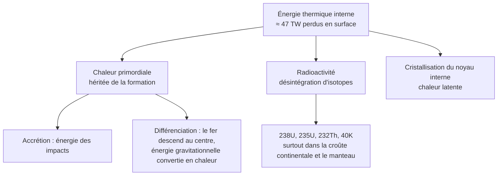
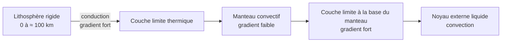

# A. Étude du gradient géothermique

## 1. Notion de gradient géothermique

!!! info "Définitions"
    - **Gradient géothermique** : augmentation de la **température** avec la **profondeur**, $\dfrac{\Delta T}{\Delta z}$, exprimée en $^\circ\text{C·km}^{-1}$.
    - **Géotherme** (ou courbe géothermique) : courbe donnant la **température en fonction de la profondeur** en un lieu donné.
    - **Isotherme** : surface de même température (par exemple l'isotherme $1300\ ^\circ\text{C}$).

!!! abstract "Ordres de grandeur à connaître"
    | Profondeur | Température approximative |
    |---|---|
    | Surface | $\approx 15\ ^\circ\text{C}$ |
    | Croûte continentale (premiers km) | gradient moyen $\approx 30\ ^\circ\text{C·km}^{-1}$ |
    | Base de la lithosphère ($\approx 100$ à $150\ \text{km}$) | $\approx 1300\ ^\circ\text{C}$ |
    | Dans le manteau convectif | gradient **faible**, de l'ordre de $0{,}3$ à $0{,}5\ ^\circ\text{C·km}^{-1}$ |
    | Limite manteau / noyau ($2900\ \text{km}$) | $\approx 3500$ à $4000\ ^\circ\text{C}$ |
    | Centre de la Terre | $\approx 5000$ à $6000\ ^\circ\text{C}$ |

!!! warning "Piège : extrapoler le gradient de la croûte"
    Avec $30\ ^\circ\text{C·km}^{-1}$ jusqu'au centre ($6371\ \text{km}$), on trouverait $30 \times 6371 \approx 190\,000\ ^\circ\text{C}$ : **absurde**. Le gradient **n'est pas constant** : il est **fort** près de la surface et **beaucoup plus faible** en profondeur. La température moyenne sur tout le rayon correspond à environ $\dfrac{5500}{6371} \approx 0{,}9\ ^\circ\text{C·km}^{-1}$.

## 2. Origine de l'énergie thermique de la Terre

!!! abstract "Les trois sources"
    1. **Chaleur résiduelle** de la formation de la Terre ($\approx 4{,}56\ \text{Ga}$) : énergie des **impacts** lors de l'**accrétion**, puis énergie **gravitationnelle** libérée par la **différenciation** (le fer, dense, a migré vers le centre).
    2. **Radioactivité** : la désintégration d'isotopes à longue demi-vie libère de la chaleur. Les principaux sont l'**uranium** ($^{238}\text{U}$, $^{235}\text{U}$), le **thorium** ($^{232}\text{Th}$) et le **potassium** ($^{40}\text{K}$).
    3. **Cristallisation de la graine** : le noyau interne grossit en libérant de la **chaleur latente**.

    Les estimations actuelles attribuent environ **la moitié** de la chaleur perdue à la **radioactivité**, le reste venant de la chaleur **primordiale** et de ses prolongements.

### Radioactivité : rappel quantitatif

!!! abstract "Loi de décroissance radioactive"
    $$N(t) = N_0\, e^{-\lambda t} \qquad \lambda = \frac{\ln 2}{t_{1/2}}$$

    | Isotope | Demi-vie $t_{1/2}$ |
    |---|---|
    | $^{238}\text{U}$ | $\approx 4{,}47\ \text{Ga}$ |
    | $^{232}\text{Th}$ | $\approx 14\ \text{Ga}$ |
    | $^{40}\text{K}$ | $\approx 1{,}25\ \text{Ga}$ |

    La proportion restante après une durée $t$ est $\left(\tfrac12\right)^{t/t_{1/2}}$.

!!! info "Où se trouve l'énergie radioactive ?"
    Ces éléments sont **concentrés** dans les roches **riches en silice** : la **croûte continentale** (granitoïdes), bien que mince, **contient une grande part** de l'uranium, du thorium et du potassium de la Terre. D'où un **flux élevé** de chaleur d'origine **crustale** sur les continents.

## 3. Modes de transfert de l'énergie thermique

!!! info "Définitions"
    - **Conduction** : transfert de chaleur **de proche en proche**, **sans déplacement de matière**, par agitation et choc entre particules. Elle domine dans les matériaux **rigides**.
    - **Convection** : transfert de chaleur **par déplacement de matière** : le matériau chaud, **moins dense**, **monte** ; le matériau froid, plus dense, **descend**. Elle exige un **milieu déformable** (fluide ou solide ductile).
    - **Rayonnement** : transfert par ondes électromagnétiques ; **négligeable** à l'intérieur de la Terre pour ce chapitre.

!!! abstract "Loi de Fourier (conduction)"
    Le flux thermique conductif est proportionnel au **gradient** de température :
    $$\varphi = \lambda\,\frac{\Delta T}{\Delta z}$$
    avec $\varphi$ en $\text{W·m}^{-2}$, $\lambda$ la **conductivité thermique** (de l'ordre de $2$ à $3\ \text{W·m}^{-1}\text{·K}^{-1}$ pour les roches) et $\dfrac{\Delta T}{\Delta z}$ en $\text{K·m}^{-1}$.

!!! warning "Points d'attention"
    - Les roches sont de **mauvaises conductrices** : pour évacuer un flux donné par **conduction**, il faut un **gradient fort**.
    - Dans le **manteau**, la roche est **solide** mais **ductile à l'échelle des temps géologiques** : elle **s'écoule** lentement (quelques centimètres par an) ; c'est ce qui permet la **convection**.
    - Le **noyau externe** liquide **convecte** aussi.

## 4. Lien entre gradient et mode de transfert

!!! abstract "Résultat à retenir"
    - **Gradient fort** ($\approx 30\ ^\circ\text{C·km}^{-1}$) $\Rightarrow$ transfert par **conduction** : **lithosphère rigide**, jusqu'à environ $100$ à $150\ \text{km}$.
    - **Gradient faible** ($\approx 0{,}3$ à $0{,}5\ ^\circ\text{C·km}^{-1}$) $\Rightarrow$ transfert par **convection** : **manteau sous la lithosphère**, car le brassage de matière **homogénéise** les températures.

!!! tip "Raisonnement à savoir refaire"
    **Constat** : le géotherme change de pente vers $100$ à $150\ \text{km}$ (fort au-dessus, faible en dessous). **Interprétation** : le **mode de transfert** change : **conduction** dans la lithosphère rigide, **convection** dans le manteau sous-jacent, plus efficace. **Conclusion** : la température du manteau est **presque homogène** à l'échelle de grandes épaisseurs, et l'essentiel de la **chute de température** se fait dans les **couches limites** (lithosphère, base du manteau).

## 5. Points d'attention de cette section

!!! warning "Erreurs fréquentes"
    - Écrire que « le gradient est constant dans la Terre » (faux : **$30$ puis $\approx 0{,}4\ ^\circ\text{C·km}^{-1}$**).
    - Confondre **gradient** (variation de $T$ avec $z$, en °C/km) et **température**.
    - Dire que la convection « transporte la chaleur sans matière » : c'est la **conduction** qui n'a pas de déplacement de matière ; la **convection** en a.
    - Penser que le manteau convecte car il est **liquide** : il est **solide mais ductile**, sa convection est **très lente**.
    - Attribuer toute la chaleur à la **radioactivité** : environ **la moitié** seulement.
