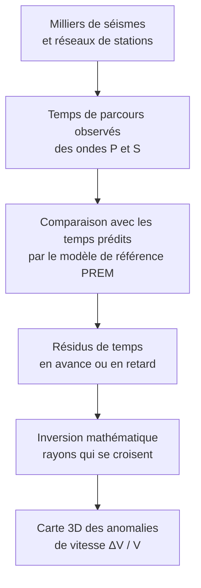
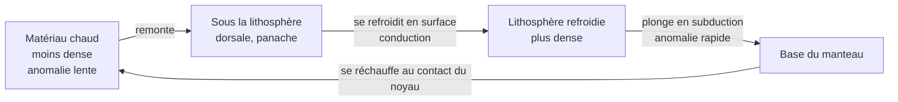

# B. Apport de la tomographie sismique

## 1. Principe de la tomographie sismique

### 1.1 Idée générale

Le modèle PREM est un modèle **moyen** : il donne **une** valeur de vitesse par profondeur. Or, un séisme enregistré à de nombreuses stations montre de **petits écarts** entre les **temps de parcours réels** et ceux **prédits** par le PREM. Ces écarts renseignent sur les **variations latérales** de vitesse, donc sur l'**état** du matériau.

!!! info "Définitions"
    - **Tomographie sismique** : technique qui reconstitue, en **trois dimensions**, les **variations de vitesse des ondes sismiques** à l'intérieur de la Terre, à partir de **très nombreux temps de parcours**.
    - **Anomalie de vitesse** : écart de vitesse, **par rapport au modèle de référence** (PREM) à la même profondeur, souvent exprimé en pourcentage : $\dfrac{\Delta V}{V} = \dfrac{V_{\text{réelle}} - V_{\text{PREM}}}{V_{\text{PREM}}}$.
    - **Anomalie positive** : l'onde va **plus vite** que dans le modèle. **Anomalie négative** : elle va **plus lentement**.

### 1.2 Démarche

!!! tip "Méthode : de l'écart de temps à l'anomalie"
    1. Une onde arrive **en avance** sur le temps prédit : elle a traversé, en moyenne, un matériau **plus rapide** que le modèle $\Rightarrow$ anomalie **positive**.
    2. Une onde arrive **en retard** : elle a traversé un matériau **plus lent** $\Rightarrow$ anomalie **négative**.
    3. Comme **des milliers de rais se croisent** dans chaque volume, on **localise** l'anomalie (comme un **scanner médical** reconstruit un organe à partir de nombreuses radiographies sous différents angles).

!!! info "Convention de représentation"
    Dans les coupes tomographiques, on représente en général les anomalies **positives** (ondes rapides) en **bleu** et les anomalies **négatives** (ondes lentes) en **rouge**. **Toujours vérifier la légende** : l'inverse est possible.

### 1.3 Interprétation : de la vitesse à la température

!!! abstract "Interprétation des anomalies"
    À composition constante, la vitesse des ondes **diminue quand la température augmente** (le matériau devient moins rigide et moins dense). Ainsi :

    | Anomalie | Vitesse | Matériau | Interprétation |
    |---|---|---|---|
    | **Positive** (bleu) | **plus rapide** | **plus froid** et plus dense | **matériau froid** (par exemple plaque lithosphérique plongeante) |
    | **Négative** (rouge) | **plus lente** | **plus chaud** et moins dense | **matériau chaud** (par exemple remontée de manteau) |

    Ordre de grandeur : une différence de température de l'ordre de $100\ ^\circ\text{C}$ produit environ $1\ \%$ d'écart de vitesse. Les anomalies tomographiques sont donc de **quelques pourcents**.

!!! warning "Points d'attention"
    - L'anomalie est **relative** : « rapide » signifie « plus rapide **que le PREM à cette profondeur** », pas « rapide en valeur absolue ».
    - La **température** n'est **pas la seule cause** : la **composition** (présence de fluide, de fusion partielle, de matériaux différents) peut aussi modifier les vitesses.
    - La **résolution** dépend de la **densité de rais** : peu de stations dans un océan ou dans l'hémisphère sud donnent des images **plus floues**.
    - La tomographie ne donne **ni** la température **ni** le mouvement **directement** : elle donne des **vitesses**, qu'on **interprète**.

## 2. Convection mantellique et conséquences

### 2.1 Ce que montre la tomographie

!!! abstract "Observations essentielles"
    - **Anomalies rapides (froides)** en forme de **panneaux inclinés**, qui **plongent** dans le manteau sous les zones de **subduction** (arcs insulaires, Andes). On les suit parfois jusqu'à $660\ \text{km}$, parfois **jusqu'à la base du manteau** ($2900\ \text{km}$) : ce sont des **lithosphères océaniques froides** qui **s'enfoncent**.
    - **Anomalies lentes (chaudes)** sous les **dorsales** (de façon superficielle) et sous les **points chauds** (colonnes qui peuvent s'enraciner profondément).
    - **Deux vastes régions lentes** à la base du manteau, sous l'**Afrique** et sous le **Pacifique**.

### 2.2 Interprétation : le manteau convecte

!!! abstract "Conclusion"
    Le manteau, solide mais **ductile**, est le siège d'une **convection** : du matériau **froid et dense** **descend** (plaques plongeantes) et du matériau **chaud et moins dense** **remonte** (dorsales, panaches). La **tomographie** met en évidence ces **courants** sous forme d'anomalies de vitesse.

!!! info "Données quantitatives"
    - Vitesses de déplacement : de l'ordre de **quelques centimètres par an**.
    - Durée d'une **traversée** du manteau par un matériau : environ **$50$ à plusieurs centaines de millions d'années**.
    - **Viscosité** du manteau : très élevée (de l'ordre de $10^{21}\ \text{Pa·s}$), mais finie : à l'échelle des temps géologiques, il **s'écoule**.

### 2.3 Conséquences de la convection

!!! abstract "Quatre conséquences"
    1. **Évacuation de la chaleur** interne : la convection est le **mode principal** de refroidissement de la Terre.
    2. **Moteur de la tectonique des plaques** (chapitre 2) : les mouvements du manteau et la **plongée** des plaques froides **entraînent** les plaques à la surface.
    3. **Renouvellement de la croûte océanique** : elle naît aux **dorsales** (remontée de matière chaude) et disparaît en **subduction** (matière froide qui replonge). Voilà pourquoi la croûte océanique a **moins de $200\ \text{Ma}$**.
    4. **Volcanisme et déformations** : la remontée de matière chaude alimente le volcanisme de **points chauds** et des **dorsales**.

!!! warning "Points d'attention"
    - La convection **n'est pas un mouvement de liquide** : le manteau est **solide** (les ondes S le traversent), mais il **flue** très lentement.
    - **Ne pas écrire** que les **plaques sont « portées » par des courants** comme des radeaux : le lien **convection - plaques** est **plus subtil** (la plaque plongeante est elle-même une partie du **système convectif**). Ce point sera approfondi au chapitre 2.
    - Les **anomalies froides profondes** ne sont pas des « trous » : c'est du **matériau solide** qui **conserve** une température plus basse que son environnement.

## 3. Méthode : rédiger une interprétation de coupe tomographique

!!! tip "Méthode en 5 étapes"
    1. **Décrire** : localiser les anomalies (profondeur, position) et leur signe, **en lisant la légende**.
    2. **Interpréter** : anomalie positive $\Rightarrow$ plus froid ; négative $\Rightarrow$ plus chaud.
    3. **Relier au contexte** : subduction (anomalie rapide inclinée), dorsale ou point chaud (anomalie lente).
    4. **Conclure** : il existe des **mouvements de matière** dans le manteau, donc une **convection**.
    5. **Nuancer** (si demandé) : résolution limitée, composition possible.

## 4. Points d'attention de cette section

!!! warning "Erreurs fréquentes"
    - Dire que « le rouge = chaud » sans vérifier : cela dépend de la **légende** ; ce qui est universel, c'est **lent = chaud**.
    - Confondre **vitesse des ondes** (km·s⁻¹) et **vitesse de déplacement du manteau** (cm/an).
    - Écrire que la tomographie **mesure** la température.
    - Affirmer que la tomographie **« voit » les courants** : elle montre des **états** (froid/chaud) qui **impliquent** des mouvements.
    - Oublier que le PREM sert de **référence** : sans lui, pas d'« anomalie ».
