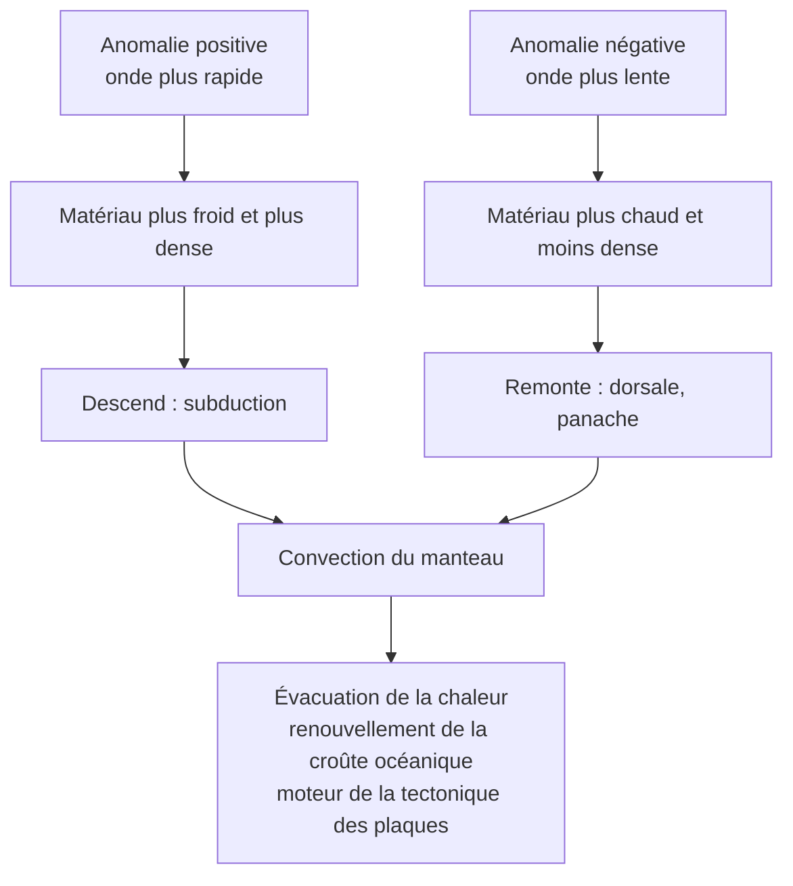

# Synthèse et fiche de révision : Apports des anomalies de vitesse des ondes sismiques

## 1. Fiche de révision

### Les faits à savoir absolument

!!! abstract "Chiffres et valeurs de référence"
    | À connaître | Valeur |
    |---|---|
    | Gradient dans la croûte | $\approx 30\ ^\circ\text{C·km}^{-1}$ |
    | Gradient dans le manteau convectif | $\approx 0{,}3$ à $0{,}5\ ^\circ\text{C·km}^{-1}$ |
    | Base de la lithosphère (isotherme) | $\approx 1300\ ^\circ\text{C}$, vers $100$ à $150\ \text{km}$ |
    | Température au centre | $\approx 5000$ à $6000\ ^\circ\text{C}$ |
    | Flux moyen / continents / océans | $\approx 87$ / $65$ / $100\ \text{mW·m}^{-2}$ |
    | Puissance totale dissipée | $\approx 44$ à $47\ \text{TW}$ |
    | Part de la radioactivité | environ **la moitié** |
    | Isotopes radioactifs principaux | $^{238}\text{U}$, $^{235}\text{U}$, $^{232}\text{Th}$, $^{40}\text{K}$ |
    | Mouvements dans le manteau | quelques $\text{cm·an}^{-1}$ |
    | $100\ ^\circ\text{C}$ | $\approx 1\ \%$ d'écart de vitesse sismique |

!!! info "Définitions à savoir rédiger"
    - **Gradient géothermique** : augmentation de la température avec la profondeur.
    - **Flux géothermique** : énergie thermique traversant une unité de surface par unité de temps ($\text{W·m}^{-2}$).
    - **Conduction** : transfert de chaleur de proche en proche, sans déplacement de matière.
    - **Convection** : transfert de chaleur par déplacement de matière.
    - **Tomographie sismique** : reconstitution 3D des variations de vitesse des ondes sismiques à partir de nombreux temps de parcours.
    - **Anomalie de vitesse** : écart de vitesse par rapport au modèle de référence à la même profondeur.

### Propriétés à savoir utiliser

!!! abstract "Les relations du chapitre"
    $$\varphi = \lambda\,\frac{\Delta T}{\Delta z} \qquad \varphi = \frac{P}{S} \qquad N(t) = N_0\,e^{-\lambda t} \qquad \frac{\Delta V}{V} = \frac{V_{\text{réelle}} - V_{\text{réf}}}{V_{\text{réf}}}$$

### Bilan : de la vitesse à la dynamique

### Pièges à éviter (liste de contrôle)

!!! warning "Avant de rendre ta copie, vérifie que tu n'as pas écrit…"
    - [ ] « Le gradient est constant » (il passe de $30$ à $\approx 0{,}4\ ^\circ\text{C·km}^{-1}$).
    - [ ] « Le flux s'exprime en watts » (en $\text{W·m}^{-2}$ ; la puissance en W).
    - [ ] « Anomalie positive = chaud » (positive = **rapide = froid**).
    - [ ] « Le manteau est liquide » (**solide ductile**).
    - [ ] « La tomographie mesure la température » (elle mesure des **vitesses**).
    - [ ] « Toute la chaleur vient de la radioactivité » (environ **la moitié**).
    - [ ] « La convection est le même phénomène que la conduction » (**matière déplacée** ou non).
    - [ ] Un calcul sans **conversion d'unités** ($\text{km} \to \text{m}$, $\mu\text{W} \to \text{W}$).
    - [ ] Une lecture de coupe sans **regarder la légende**.

### Réflexes pour l'analyse de documents

!!! tip "Méthode"
    1. **Lire la légende** et repérer le signe des anomalies.
    2. **Chiffrer** (valeurs de $\Delta V/V$, de flux, de gradient).
    3. **Interpréter** : vitesse $\to$ température $\to$ mouvement de matière.
    4. **Croiser** avec une donnée de contexte (subduction, dorsale, flux).
    5. **Conclure** sur la **convection** ou le **mode de transfert**.

---

## 2. Comprendre pourquoi, savoir quand l'utiliser, savoir démontrer

### 2.1 Pourquoi le gradient diminue-t-il avec la profondeur ?

- **Pourquoi** : dans la lithosphère rigide, la chaleur se transmet par **conduction**, mode peu efficace, qui demande un **gradient fort**. Sous la lithosphère, la **convection** brasse la matière et **homogénéise** les températures, donc le gradient est **faible**.
- **Quand l'utiliser** : devant un géotherme, pour justifier un **changement de pente** et le **changement de mode de transfert**.
- **Démonstration** : $\varphi = \lambda\,\Delta T/\Delta z$ : à flux $\varphi$ conservé, un faible $\lambda$ impose un fort gradient ; la convection **court-circuite** cette limite.

### 2.2 Pourquoi le flux est-il plus élevé aux dorsales ?

- **Pourquoi** : la lithosphère y est **mince**, de la matière **chaude** remonte : l'isotherme $1300\ ^\circ\text{C}$ est proche de la surface, donc le **gradient** et le **flux** sont forts.
- **Quand l'utiliser** : devant une carte de flux, pour relier flux élevé et **remontée de matière chaude**.

### 2.3 Pourquoi une onde plus rapide traduit-elle un matériau plus froid ?

- **Pourquoi** : en chauffant, un matériau devient **moins rigide** et **moins dense** ; selon $V_S = \sqrt{\mu/\rho}$ et la réponse de $\mu$ à la température, **la vitesse diminue** avec la température.
- **Quand l'utiliser** : à chaque **lecture d'anomalie tomographique**, **à composition supposée constante**.
- **Limite** : la **composition** ou la présence de **fluide** peut aussi modifier la vitesse.

### 2.4 Pourquoi la tomographie prouve-t-elle la convection ?

- **Pourquoi** : elle montre simultanément des **zones froides** qui **plongent** (subduction) et des **zones chaudes** qui **remontent** (dorsale, panache), organisées en **boucle** : c'est la signature d'une **convection**.
- **Quand l'utiliser** : pour répondre à « **quel argument** démontre un mouvement dans le manteau solide ? ».

### 2.5 Ce qu'il faut être capable de faire seul(e)

!!! success "Auto-évaluation"
    - [ ] Je sais **décrire** un géotherme et **justifier** l'évolution du gradient.
    - [ ] Je sais citer **trois sources** d'énergie thermique et **calculer** une décroissance radioactive.
    - [ ] Je sais **distinguer** conduction et convection et **relier** gradient et mode de transfert.
    - [ ] Je sais **calculer** un flux (loi de Fourier) et une puissance totale.
    - [ ] Je sais **expliquer** le principe de la tomographie et **interpréter** le signe d'une anomalie.
    - [ ] Je sais **conclure** à une convection et en **donner les conséquences**.

**Suite du cours** : Chapitre 2, *De la mobilité horizontale à la tectonique des plaques*.
