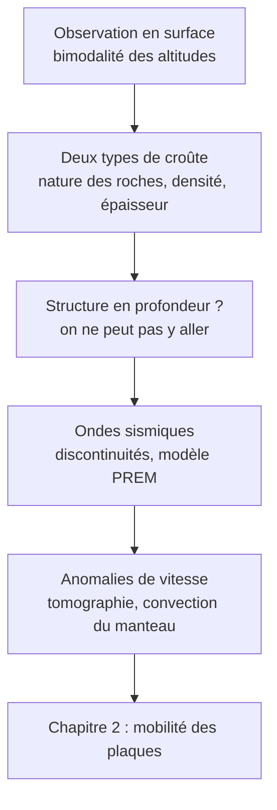

# Chapitre 1 : Organisation du globe

!!! abstract "Problématique du chapitre"
    Comment, **sans jamais avoir observé l'intérieur de la Terre**, les géologues ont-ils pu établir sa structure en enveloppes concentriques et comprendre que cette structure est liée à une dynamique interne ?

## Plan du chapitre

| Partie | Contenu | Statut |
|---|---|---|
| **1. Organisation de la Terre en surface** | Bimodalité des altitudes, roches des croûtes continentale et océanique, lien entre les deux | ✅ disponible |
| **2. Détermination des grandes enveloppes** | Bases de sismologie, régimes de contraintes, discontinuités sismiques, modèle PREM | ✅ disponible |
| **3. Apports des anomalies de vitesse des ondes sismiques** | Gradient géothermique, flux géothermique, tomographie, convection mantellique | ✅ disponible |

## Fil conducteur

!!! tip "Comment utiliser ce cours"
    1. Lis d'abord la page **Objectifs et prérequis** de chaque partie.
    2. Étudie le cours, puis refais **sans regarder** les exemples corrigés.
    3. Fais les exercices progressifs, puis les exercices type contrôle **en temps limité**.
    4. Termine par la **synthèse** et la section « Comprendre, savoir quand l'utiliser, savoir démontrer ».

!!! info "Convention des encadrés"
    - **Définition** (bleu) : à connaître mot pour mot ou presque.
    - **Propriété / résultat** (violet) : énoncé à savoir utiliser et justifier.
    - **Point d'attention** (orange) : piège ou erreur fréquente.
    - **Méthode** (vert) : démarche à appliquer en contrôle.
    - **Exemple** (gris) : application directe.
    - **Corrigé** (vert, repliable) : à ouvrir seulement après avoir cherché.
