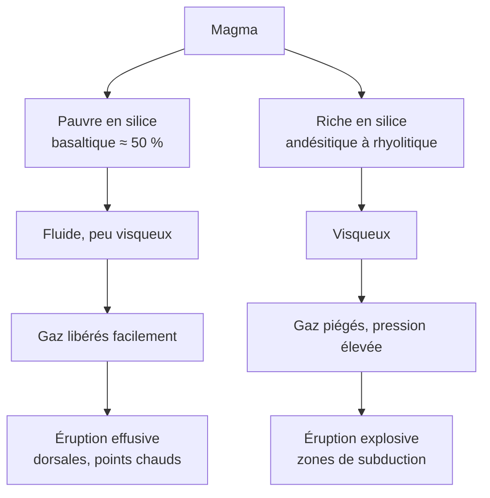

# A. Répartition de l'activité géologique terrestre

## 1. Répartition des séismes

!!! abstract "Observation"
    Les **épicentres** des séismes ne sont **pas répartis au hasard** : ils forment des **bandes étroites** et **continues** (quelques dizaines à centaines de kilomètres de large), qui **entourent** de vastes régions presque **asismiques** (intérieur des continents stables, grands bassins océaniques).

On distingue trois grands ensembles :

- la **ceinture circum-Pacifique** (« ceinture de feu ») ;
- la **ceinture alpino-himalayenne** (de la Méditerranée à l'Indonésie) ;
- les **dorsales océaniques** (rides médio-océaniques).

### Profondeur des foyers

| Contexte | Profondeur des foyers | Remarque |
|---|---|---|
| **Dorsales** | **superficiels** (quelques km), $< 30\ \text{km}$ | magnitude modérée |
| **Failles transformantes** | **superficiels** | peuvent être violents (San Andreas) |
| **Collisions** (Alpes, Himalaya) | **superficiels à intermédiaires** | nombreux |
| **Subductions** | de $0$ à **$\approx 700\ \text{km}$** | foyers **alignés sur un plan incliné** (plan de Wadati-Benioff) |

!!! tip "Méthode : lire un plan de Wadati-Benioff"
    Sur une coupe perpendiculaire à une fosse, les foyers se disposent le long d'un **plan incliné** qui plonge **sous** la plaque chevauchante. **Le pendage** de ce plan se calcule par $\tan\alpha = \dfrac{\Delta\,\text{profondeur}}{\Delta\,\text{distance horizontale}}$. Ce plan **dessine** la **plaque plongeante**, froide et cassante.

## 2. Répartition des volcans

!!! abstract "Observation"
    Les **volcans** sont également distribués selon des **alignements** :

    - le long des **zones de subduction** (arcs volcaniques : Andes, Japon, Petites Antilles) ;
    - le long des **dorsales** (le plus souvent sous la mer, avec des **émergences** en Islande) ;
    - isolés **à l'intérieur des plaques** (Hawaï, La Réunion) : volcans de **points chauds**.

    Environ **les trois quarts** du magma produit annuellement le sont **aux dorsales**, sous la mer, donc **peu visibles**.

### 2.1 Deux types de dynamismes

!!! info "Définitions"
    - **Volcanisme effusif** : éruption **calme**, **coulées de lave fluide** qui s'écoulent ; peu d'explosions.
    - **Volcanisme explosif** : éruption **violente**, projection de **cendres, de blocs et de gaz** (**pyroclastites**), parfois **nuées ardentes**.

| | **Volcanisme effusif** | **Volcanisme explosif** |
|---|---|---|
| **Lave** | **basaltique** | **andésitique** à **rhyolitique** |
| **Teneur en silice $\text{SiO}_2$** | faible ($\approx 50\ \%$) | plus élevée ($\approx 55$ à $70\ \%$ et plus) |
| **Viscosité** | **faible** (lave fluide) | **forte** (lave visqueuse, pâteuse) |
| **Gaz dissous** (eau surtout) | peu, s'échappent **facilement** | beaucoup, **piégés** |
| **Produits** | coulées, fontaines de lave | cendres, ponces, nuées ardentes, dômes |
| **Localisation** | **dorsales**, **points chauds**, rifts | **zones de subduction** |
| **Exemples** | Piton de la Fournaise, Kilauea, Islande | Montagne Pelée (1902), Pinatubo (1991), Saint Helens (1980) |

!!! abstract "Pourquoi le dynamisme dépend-il de la composition ?"
    - Plus un magma est **riche en silice**, plus il est **visqueux** (les chaînes de silicates se lient fortement).
    - Un magma **fluide** (basalte) laisse les **gaz s'échapper** progressivement : **peu de pression** s'accumule, l'éruption est **effusive**.
    - Un magma **visqueux** (andésite, rhyolite) **piège** les gaz : la **pression augmente** jusqu'à **l'explosion**, avec fragmentation du magma.

!!! warning "Points d'attention"
    - **Effusif ne veut pas dire « sans danger »** : une coulée de lave peut détruire des habitations. On caractérise ici le **dynamisme**, pas le risque.
    - **Ne pas confondre** **explosif** et **gros** : le facteur est la **viscosité et la teneur en gaz**, pas le volume.
    - L'**Islande** associe **dorsale et point chaud** : le volcanisme y est surtout **effusif**, avec des épisodes **explosifs** quand le magma rencontre de l'eau ou de la glace.
    - Un **volcan effusif** peut produire des **projections** (fontaines de lave) : c'est le **rapport coulées/projections** qui compte.

### 2.2 Pourquoi cette répartition ? (pour comprendre)

!!! note "Hors programme strict : mécanismes de production des magmas"
    - **Dorsales** et **points chauds** : le manteau **remonte** (convection), la **pression baisse**, la péridotite **fond partiellement** par **décompression** : magma **basaltique**.
    - **Subductions** : la plaque plongeante libère de l'**eau** qui **abaisse la température de fusion** de la péridotite du manteau sus-jacent : **fusion partielle hydratée**, magma **riche en eau** qui évolue vers des compositions **andésitiques**.

## 3. Du constat à l'hypothèse

!!! tip "Raisonnement scientifique"
    1. **Constat 1** : séismes et volcans sont **concentrés** dans des **bandes étroites** ; ailleurs, **très peu** d'activité.
    2. **Constat 2** : ces bandes **délimitent** des **domaines** presque **sans activité**.
    3. **Hypothèse** : ces domaines sont des **blocs rigides**, qui **se déplacent les uns par rapport aux autres** ; l'activité se **concentre** aux **limites**, là où les blocs interagissent.
    4. **Conséquence testable** : si les blocs bougent, on doit pouvoir **mesurer** leurs déplacements (partie 2) et en retrouver des **traces dans le passé** (partie 3).

## 4. Points d'attention de cette section

!!! warning "Erreurs fréquentes"
    - Dire que « les séismes ont lieu **partout** » : ils sont **concentrés** en bandes **étroites**.
    - Écrire que **tous** les volcans sont en subduction : il y a aussi **dorsales** et **points chauds**.
    - Associer **explosif** à **dorsale** ou **effusif** à **subduction** : c'est **l'inverse**.
    - Oublier que le volcanisme de **dorsale** est **sous-marin** : il est **peu visible**.
    - Utiliser « magma » pour désigner la lave **sortie** du volcan : le **magma** est en **profondeur** ; la **lave** est le magma **dégazé** émis en surface.
