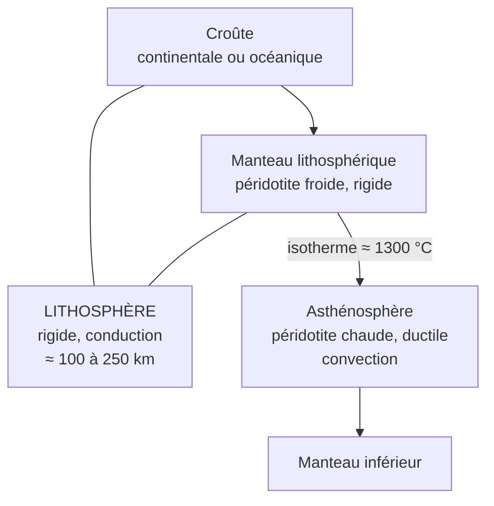
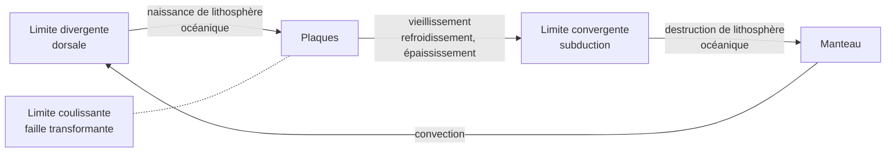

# B. Notion de plaque lithosphérique

## 1. La lithosphère : définition

!!! info "Définitions"
    - **Lithosphère** : enveloppe **externe rigide** de la Terre, qui comprend la **croûte** et la **partie supérieure du manteau**. Elle se comporte de manière **cassante** et se déplace **comme un bloc**.
    - **Asthénosphère** : partie du manteau **située sous la lithosphère**, **plus ductile** (proche de sa température de fusion), sur laquelle la lithosphère **glisse**.
    - **Plaque lithosphérique** : portion de lithosphère **rigide**, **délimitée** par des zones d'activité géologique (limites de plaques), **qui se déplace** par rapport aux plaques voisines.

!!! abstract "Épaisseur de la lithosphère"
    | | Épaisseur |
    |---|---|
    | **Lithosphère océanique** | de $\approx 0$ à la dorsale à **$\approx 100\ \text{km}$** pour les plus âgées |
    | **Lithosphère continentale** | **$\approx 100$ à $250\ \text{km}$** (plus de $150\ \text{km}$ sous les cratons) |
    | **Limite lithosphère / asthénosphère** | **isotherme $\approx 1300\ ^\circ\text{C}$** (limite **thermique et mécanique**) |

!!! warning "Piège fondamental : lithosphère ≠ croûte"
    - **Croûte / manteau** : limite de **nature chimique** (roches différentes), le **Moho**, à $\approx 7$ à $70\ \text{km}$.
    - **Lithosphère / asthénosphère** : limite de **comportement mécanique** (rigide / ductile), déterminée par la **température** ($\approx 1300\ ^\circ\text{C}$), à $\approx 100$ à $250\ \text{km}$.
    - Une plaque **contient donc du manteau** : la lithosphère comprend la croûte **et** le **manteau lithosphérique** (péridotite froide et rigide).

### 1.1 Pourquoi la lithosphère est-elle rigide ?

D'après le chapitre 1, le **transfert de chaleur** est assuré par **conduction** dans la lithosphère : la température y **augmente rapidement** avec la profondeur. En surface, les roches sont **froides** : elles sont **rigides** et **cassantes**. Quand la température approche $1300\ ^\circ\text{C}$, les roches deviennent **ductiles** : c'est l'**asthénosphère**, où le matériau **flue** lentement (convection).

## 2. Les plaques et leurs limites

### 2.1 Les grandes plaques

La lithosphère est divisée en **$7$ grandes plaques** et plusieurs plus petites :

- **grandes plaques** : Pacifique, Amérique du Nord, Amérique du Sud, Eurasie, Afrique, Indo-Australie, Antarctique ;
- **plaques plus petites** : Nazca, Cocos, Caraïbes, Philippines, Arabie, Inde (selon les découpages), etc.

!!! warning "Points d'attention"
    - Une plaque **n'est pas** un continent ni un océan : une même plaque peut **porter à la fois** de la lithosphère **continentale** et **océanique** (Amérique du Sud : continent + moitié ouest de l'Atlantique sud).
    - Les **limites de plaques** ne **coïncident** pas avec les **côtes**.

### 2.2 Trois types de limites

| Type de limite | Mouvement relatif | Régime | Structures | Activité |
|---|---|---|---|---|
| **Divergente** | écartement | **extensif** | **dorsales**, **rifts** | séismes **superficiels** ; volcanisme **effusif** basaltique ; **création** de lithosphère océanique |
| **Convergente** | rapprochement | **compressif** | **subduction** (fosse, arc volcanique), **collision** (chaîne de montagnes) | séismes **superficiels à profonds** ; volcanisme **explosif** (subduction) ; **destruction** de lithosphère océanique |
| **Coulissante** (transformante) | glissement latéral | **coulissant** | **failles transformantes**, décalages de dorsales | séismes **superficiels** ; **pas de volcanisme** significatif |

!!! abstract "Subduction et collision : deux cas de limite convergente"
    - **Subduction** : une lithosphère **océanique**, plus **dense**, plonge sous une autre lithosphère. Elle forme une **fosse océanique**, un **plan de Wadati-Benioff** et un **arc volcanique**.
    - **Collision** : quand deux lithosphères **continentales** (de densité faible) se rencontrent, **aucune** ne plonge facilement : la croûte **s'épaissit** (chaîne de montagnes, **racines crustales**), la déformation est **intense**, le volcanisme **faible ou absent**.

## 3. Rigidité des plaques

!!! abstract "Propriété"
    Une plaque est un **bloc rigide** : sa **déformation interne** est **très faible**, et l'**activité** géologique est **concentrée** à ses **limites**. Ses mouvements sont des **translations/rotations d'ensemble** à la surface de la sphère.

!!! tip "Comment le justifier"
    - **Absence** presque totale de séismes et de volcans **à l'intérieur** des plaques (hors points chauds).
    - **Mesures de géodésie** (partie 2) : des **stations** situées sur une **même plaque** gardent une **distance constante** entre elles (à quelques mm/an), alors que les distances entre stations de **plaques différentes** varient.
    - **Cohérence** des vitesses sur de grandes surfaces.

## 4. Lien avec la dynamique du manteau (chapitre 1)

!!! info "Bilan"
    - Les **dorsales** : remontée de **matière chaude** (anomalies lentes en tomographie).
    - Les **subductions** : **plongée** de **matière froide** (anomalies rapides).
    - Le **refroidissement** et l'**épaississement** de la lithosphère océanique avec l'**âge** la rendent **plus dense** que l'asthénosphère, ce qui **favorise** sa plongée.
    - La **convection du manteau** et les **mouvements de plaques** sont **liés** : les plaques sont l'**expression en surface** de la dynamique interne.

## 5. Points d'attention de cette section

!!! warning "Erreurs fréquentes"
    - Dire que « les plaques **flottent sur le magma** » : l'asthénosphère est **solide mais ductile** (pas de « mer de magma »).
    - Assimiler **croûte** et **plaque**.
    - Écrire « **croûte océanique** = **plaque océanique** ».
    - Confondre **limite divergente** (création) et **convergente** (destruction).
    - Dire que **toutes** les limites convergentes produisent un **arc volcanique** (pas les **collisions**).
    - Oublier que les **failles transformantes** n'ont **ni création ni destruction** de lithosphère.
