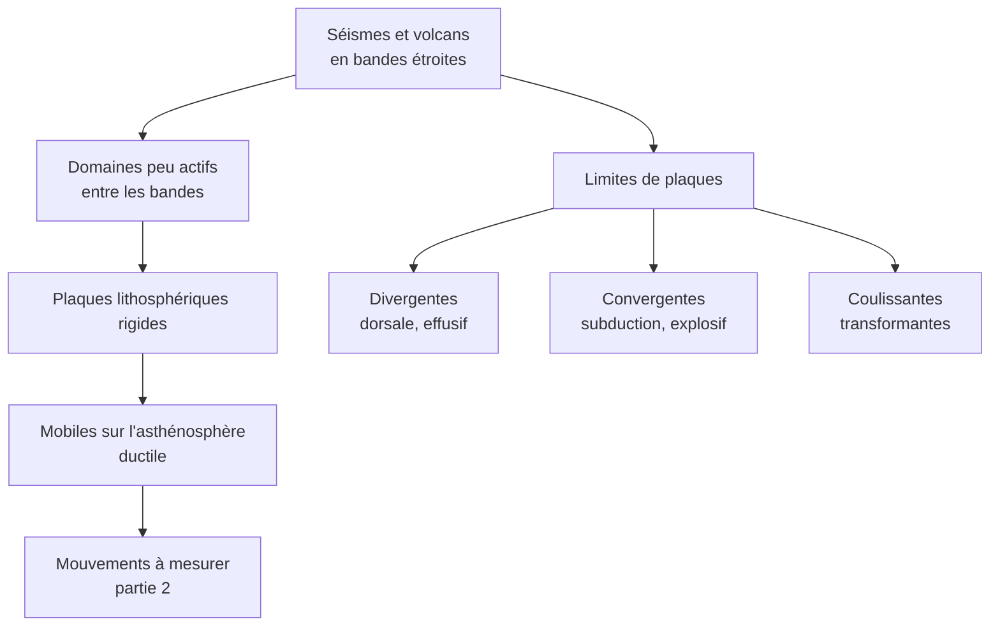

# Synthèse et fiche de révision : Une lithosphère découpée en plaques

## 1. Fiche de révision

### Les faits à savoir absolument

!!! abstract "Chiffres et valeurs de référence"
    | À connaître | Valeur |
    |---|---|
    | Nombre de grandes plaques | $7$ |
    | Épaisseur de la lithosphère océanique | de $\approx 0$ (dorsale) à $\approx 100\ \text{km}$ |
    | Épaisseur de la lithosphère continentale | $\approx 100$ à $250\ \text{km}$ |
    | Limite lithosphère / asthénosphère | isotherme $\approx 1300\ ^\circ\text{C}$ |
    | Profondeur maximale des foyers | $\approx 700\ \text{km}$ (subduction) |
    | Silice du basalte / de l'andésite | $\approx 50\ \%$ / $\approx 60\ \%$ |
    | Part du magma produite aux dorsales | environ les trois quarts |
    | Âge maximal de la croûte océanique | $\approx 180$ à $200\ \text{Ma}$ |

!!! info "Définitions à savoir rédiger"
    - **Lithosphère** : enveloppe externe rigide, comprenant la croûte et la partie supérieure du manteau, limitée à sa base par l'isotherme $1300\ ^\circ\text{C}$.
    - **Asthénosphère** : partie du manteau sous la lithosphère, solide mais ductile.
    - **Plaque lithosphérique** : portion de lithosphère rigide délimitée par des zones d'activité (limites), mobile par rapport aux plaques voisines.
    - **Volcanisme effusif** : coulées de lave fluide, peu d'explosions. **Volcanisme explosif** : projections de cendres, ponces, nuées ardentes.
    - **Plan de Wadati-Benioff** : plan incliné de foyers sismiques marquant la plaque plongeante.

### Tableau des limites de plaques

| Limite | Mouvement | Régime | Séismes | Volcanisme |
|---|---|---|---|---|
| **Divergente** (dorsale, rift) | écartement | extensif | superficiels | **effusif** basaltique |
| **Convergente** : subduction | rapprochement | compressif | **0 à 700 km**, plan de Benioff | **explosif** andésitique |
| **Convergente** : collision | rapprochement | compressif | superficiels à intermédiaires | faible ou absent |
| **Coulissante** (transformante) | glissement latéral | coulissant | superficiels | aucun |

### Schéma bilan

### Pièges à éviter (liste de contrôle)

!!! warning "Avant de rendre ta copie, vérifie que tu n'as pas écrit…"
    - [ ] « Lithosphère = croûte » (elle contient aussi du **manteau**).
    - [ ] « Plaque = continent » (une plaque peut porter **continent et océan**).
    - [ ] « Les plaques flottent sur du **magma** » (asthénosphère **solide ductile**).
    - [ ] « Effusif = subduction » ou « explosif = dorsale » (c'est **l'inverse**).
    - [ ] « Les séismes sont répartis **partout** » (**bandes étroites**).
    - [ ] « Toute limite convergente a un arc volcanique » (pas en **collision**).
    - [ ] « Une transformante crée de la lithosphère » (elle **n'en crée ni n'en détruit**).
    - [ ] « Le magma est la lave » (la **lave** est le magma **émis**).
    - [ ] Une description de carte **sans valeur chiffrée**.

### Réflexes pour l'analyse de documents

!!! tip "Méthode"
    1. **Décrire** la répartition (bandes, largeur, profondeur) avec des **valeurs**.
    2. **Classer** par contexte (dorsale, subduction, intraplaque).
    3. **Interpréter** : domaines inactifs = blocs rigides ; bandes actives = limites.
    4. **Conclure** sur le **découpage en plaques** et le **type de limite**.

---

## 2. Comprendre pourquoi, savoir quand l'utiliser, savoir démontrer

### 2.1 Pourquoi les séismes et les volcans dessinent-ils des plaques ?

- **Pourquoi** : une plaque rigide **ne se déforme presque pas** : toute la **déformation** et donc l'**activité** se **concentre** aux limites, où les plaques se **déplacent l'une par rapport à l'autre**.
- **Quand l'utiliser** : devant une **carte de séismes ou de volcans** pour **définir** des plaques.
- **Démonstration** : constat (bandes étroites, régions asismiques) $\to$ hypothèse (blocs rigides mobiles) $\to$ **test** par des mesures (partie 2).

### 2.2 Pourquoi les volcans de subduction sont-ils explosifs ?

- **Pourquoi** : l'**eau** libérée par la plaque plongeante abaisse la température de fusion du manteau sus-jacent ; le magma est **riche en eau** et **en silice**, donc **visqueux** et **gazeux**.
- **Quand l'utiliser** : pour relier un **dynamisme** à un **contexte**.
- **Démonstration** : viscosité $\approx 10^5\ \text{Pa·s}$ contre $10^2$ pour un basalte, avec $\approx 3\ \%$ d'eau.

### 2.3 Pourquoi la lithosphère est-elle rigide et l'asthénosphère ductile ?

- **Pourquoi** : la **température** monte avec la profondeur (conduction dans la lithosphère). Vers $1300\ ^\circ\text{C}$, la péridotite devient **ductile**.
- **Quand l'utiliser** : pour distinguer **lithosphère** et **croûte**, et pour comprendre que les plaques **glissent**.
- **Lien avec le chapitre 1** : la limite correspond au **changement de mode de transfert** (conduction vers convection).

### 2.4 Ce qu'il faut être capable de faire seul(e)

!!! success "Auto-évaluation"
    - [ ] Je sais **décrire** la répartition des séismes et des volcans, **avec des valeurs**.
    - [ ] Je sais **distinguer** effusif et explosif et les **relier au contexte**.
    - [ ] Je sais **définir** lithosphère, asthénosphère, plaque.
    - [ ] Je sais **identifier** les trois types de limites et leur activité.
    - [ ] Je sais **justifier** le caractère **rigide** des plaques.
    - [ ] Je sais rédiger une **analyse de documents** en quatre temps.

**Suite du cours** : Partie 2, *Déterminer le mouvement actuel et absolu des plaques lithosphériques*.
