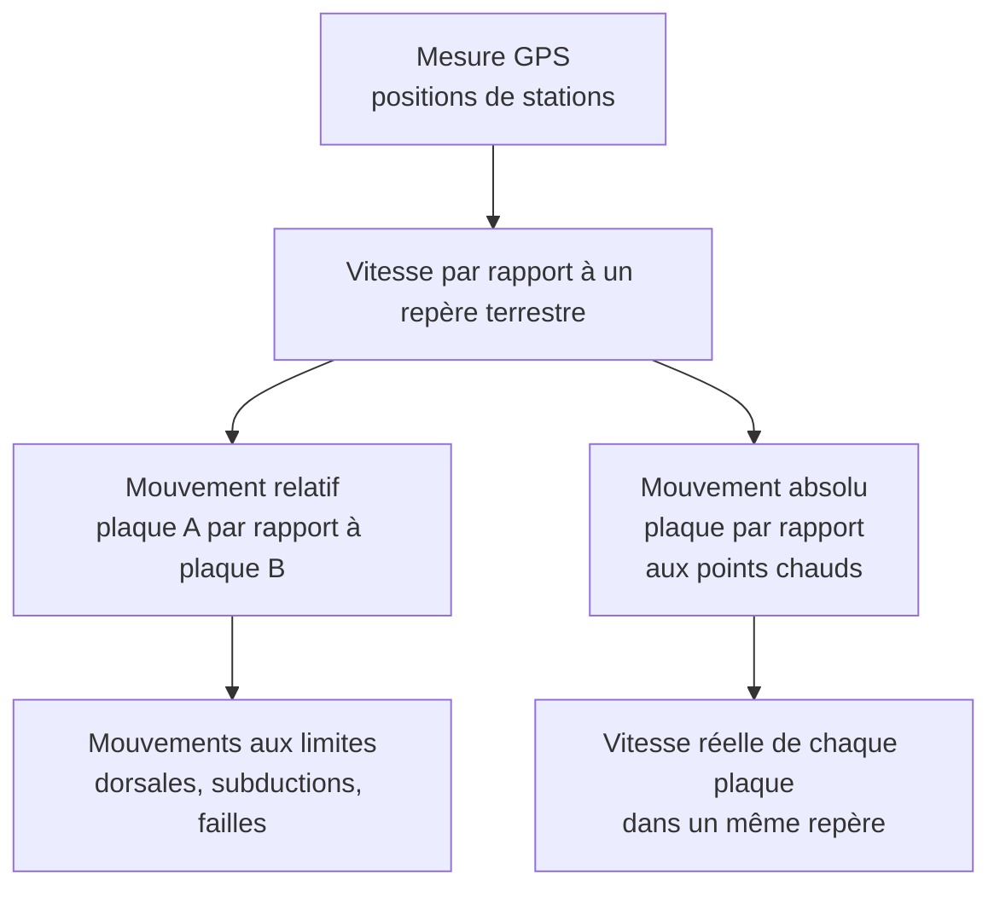

# A. Principes : mesurer et décrire un mouvement de plaque

## 1. Mesurer un déplacement : la géodésie spatiale

### 1.1 Le principe du GPS (GNSS)

!!! info "Définitions"
    - **Géodésie** : science de la mesure de la **forme** de la Terre et de la **position** de points à sa surface.
    - **GPS / GNSS** : système de positionnement par **satellites** (GPS américain, Galileo européen, GLONASS russe…).
    - **Station GPS permanente** : récepteur **fixé au sol** (roche stable) qui enregistre en continu pendant des années.
    - **Série temporelle** : position de la station en fonction du temps.

!!! abstract "Principe du positionnement"
    1. Chaque **satellite** émet un signal radio contenant **l'heure d'émission**.
    2. Le **récepteur** mesure le **temps de propagation** $\Delta t$ du signal et en déduit la **distance** au satellite :
       $$d = c\,\Delta t$$
    3. Avec **au moins 4 satellites** (trois pour les coordonnées $x, y, z$, un pour corriger l'horloge du récepteur), on **localise** le récepteur par **intersection de sphères**.

!!! example "Exemple corrigé"
    Un signal met $0{,}0702\ \text{s}$ pour parvenir d'un satellite à un récepteur. Quelle est la distance ? Quelle erreur de distance provoque une erreur d'horloge de $1\ \mu\text{s}$ ?

??? success "Corrigé"
    $d = c\,\Delta t = 3{,}00\times10^{8} \times 0{,}0702 \approx 2{,}11\times10^{7}\ \text{m} = 21\,100\ \text{km}$.

    Une erreur de $1\ \mu\text{s} = 10^{-6}\ \text{s}$ donne $\delta d = 3{,}00\times10^{8}\times10^{-6} = 300\ \text{m}$. D'où l'exigence d'**horloges très précises** et d'un **traitement différentiel** pour atteindre le **millimètre**.

!!! warning "Points d'attention"
    - La mesure instantanée d'un GPS « de poche » est précise à quelques **mètres**. Les **stations géodésiques** utilisent la **phase** du signal et des **corrections**, ce qui atteint **quelques millimètres**.
    - On ne détecte un déplacement de plaque que sur **plusieurs années** : un déplacement de $2$ à $10\ \text{cm·an}^{-1}$ est **très inférieur** au bruit d'une mesure isolée mais devient **évident** sur une **série temporelle**.

### 1.2 Calculer une vitesse

!!! tip "Méthode : vitesse d'une station"
    1. **Tracer** la position (est, nord) en fonction du **temps** sur plusieurs années.
    2. La **pente** de la courbe donne la **vitesse** : $v = \dfrac{\Delta d}{\Delta t}$.
    3. Pour un **vecteur** : calculer les **deux composantes** $v_E$ et $v_N$, puis $v = \sqrt{v_E^2 + v_N^2}$ et la **direction**.
    4. **Convertir** : on exprime les vitesses de plaques en **$\text{cm·an}^{-1}$** (ou $\text{mm·an}^{-1}$).

!!! example "Exemple corrigé"
    Une station sur la plaque Pacifique se déplace en $10$ ans de $0{,}30\ \text{m}$ vers l'**ouest** et de $0{,}65\ \text{m}$ vers le **nord**. Calculer sa vitesse et sa direction.

??? success "Corrigé"
    Déplacement total : $\sqrt{0{,}30^2 + 0{,}65^2} = \sqrt{0{,}5125} \approx 0{,}716\ \text{m}$.

    Vitesse : $\dfrac{0{,}716}{10} \approx 0{,}0716\ \text{m·an}^{-1} \approx 7{,}2\ \text{cm·an}^{-1}$.

    Direction : $\arctan\dfrac{0{,}30}{0{,}65} \approx 25^\circ$ à l'**ouest du nord**, soit vers le **nord-nord-ouest**.

### 1.3 D'autres techniques

!!! info "Pour compléter"
    - **VLBI** (interférométrie à très longue base) : observation de **quasars** lointains par des radiotélescopes.
    - **Télémétrie laser sur satellites** (SLR) et **DORIS**.
    - **Interférométrie radar** (InSAR) : cartes de **déformation** de surface.

    Ces techniques **concordent** avec le GPS.

## 2. Mouvement relatif et mouvement absolu

### 2.1 Le problème du référentiel

!!! abstract "Principe : un mouvement se décrit toujours par rapport à un référentiel"
    Dire qu'une plaque « se déplace à $5\ \text{cm·an}^{-1}$ » n'a **aucun sens** sans préciser **par rapport à quoi**.

!!! info "Définitions"
    - **Mouvement relatif** : mouvement d'une plaque **par rapport à une autre plaque** (choisie fixe). Il **dépend** du choix de la plaque de référence.
    - **Mouvement absolu** : mouvement d'une plaque **par rapport à un référentiel supposé fixe** extérieur aux plaques : le **manteau profond**, matérialisé par les **points chauds**.
    - **Référentiel des points chauds** : ensemble de **points chauds** considérés comme **fixes** (ou presque) les uns par rapport aux autres.

### 2.2 Pourquoi les points chauds ?

Un **point chaud** est le **volcan** d'une **remontée de matière chaude** issue du manteau **profond** (panache). Ces panaches sont **peu mobiles** (de l'ordre de $1\ \text{cm·an}^{-1}$ ou moins) alors que les plaques se déplacent de **1 à plus de $10\ \text{cm·an}^{-1}$** : on peut donc les prendre comme **repère** (voir partie 3).

!!! warning "Précision"
    La **fixité** des points chauds est une **approximation** : certains points chauds dérivent lentement. Le **référentiel des points chauds** est un **modèle** commode pour définir un mouvement **absolu**.

### 2.3 Composition des vitesses

!!! abstract "Propriété : composition des vitesses (vecteurs)"
    Pour trois solides A, B et C :
    $$\vec{v}_{A/C} = \vec{v}_{A/B} + \vec{v}_{B/C}$$

    En particulier, la **vitesse relative** de deux plaques A et B dans le **référentiel des points chauds** (H) est :
    $$\vec{v}_{A/B} = \vec{v}_{A/H} - \vec{v}_{B/H}$$

!!! example "Exemple corrigé (en une dimension)"
    Selon un axe est-ouest, l'**Amérique du Sud** se déplace de $1{,}0\ \text{cm·an}^{-1}$ **vers l'ouest** ($-1{,}0$) et l'**Afrique** de $2{,}0\ \text{cm·an}^{-1}$ **vers l'est** ($+2{,}0$) par rapport aux points chauds. Quelle est la vitesse d'**ouverture** de l'Atlantique ?

??? success "Corrigé"
    $v_{\text{Afrique/Amérique du Sud}} = +2{,}0 - (-1{,}0) = +3{,}0\ \text{cm·an}^{-1}$ : l'Atlantique s'ouvre de **$3{,}0\ \text{cm·an}^{-1}$**.

    En prenant l'**Afrique** comme référence **fixe**, l'Amérique du Sud se déplace à $-3{,}0\ \text{cm·an}^{-1}$ : un **relatif** ne dit pas **laquelle bouge**. C'est le **référentiel absolu** qui précise la **contribution** de chaque plaque.

## 3. Décrire un mouvement de plaque sur la sphère (approfondissement)

!!! note "Niveau du programme"
    Ce paragraphe dépasse le programme de 1ère ; il explique **pourquoi** les vitesses varient le long d'une limite et pourquoi les failles transformantes ont une direction particulière. Tu peux l'ignorer pour le contrôle, mais il aide à **comprendre**.

!!! abstract "Rotation d'Euler"
    Une plaque rigide se déplace sur la sphère par une **rotation** autour d'un **axe passant par le centre de la Terre**. Cet axe perce la surface en un **pôle de rotation** (pôle d'Euler), avec une **vitesse angulaire** $\omega$ en $^\circ\text{·Ma}^{-1}$.

    La **vitesse linéaire** en un point à la **distance angulaire** $\theta$ du pôle vaut :
    $$v = \omega\,R_T\,\sin\theta$$

    - $v = 0$ au pôle ; $v$ est **maximale** à $90^\circ$ du pôle.
    - Les **failles transformantes** suivent des **petits cercles** centrés sur le pôle (elles sont **parallèles** au mouvement relatif).
    - Les **dorsales** sont, en gros, **perpendiculaires** à ces petits cercles : le **taux d'ouverture varie le long d'une dorsale**.

!!! example "Exemple corrigé"
    Avec $\omega = 0{,}8^\circ\text{·Ma}^{-1}$, calculer $v$ à $\theta = 90^\circ$.

??? success "Corrigé"
    $\omega = 0{,}8\times\dfrac{\pi}{180} = 0{,}01396\ \text{rad·Ma}^{-1} = 1{,}396\times10^{-8}\ \text{rad·an}^{-1}$.

    $v = 1{,}396\times10^{-8}\times 6{,}371\times10^{6} \times \sin 90^\circ \approx 0{,}089\ \text{m·an}^{-1} \approx 8{,}9\ \text{cm·an}^{-1}$.

## 4. Points d'attention de cette section

!!! warning "Erreurs fréquentes"
    - Donner une vitesse de plaque **sans référentiel**.
    - Confondre **vitesse relative** (entre deux plaques) et **absolue** (par rapport aux points chauds).
    - Oublier de **convertir** les unités (mm, cm, m ; ans, Ma).
    - Dire que « le GPS mesure la vitesse des **plaques** » : il mesure celle de **stations**, qu'on **attribue** aux plaques **si** les stations sont stables.
    - Penser qu'un point chaud est « **immobile dans l'absolu** » : il est **quasi fixe** par rapport au **manteau profond**.
    - Additionner les vitesses sans tenir compte de leur **sens** (signes).
