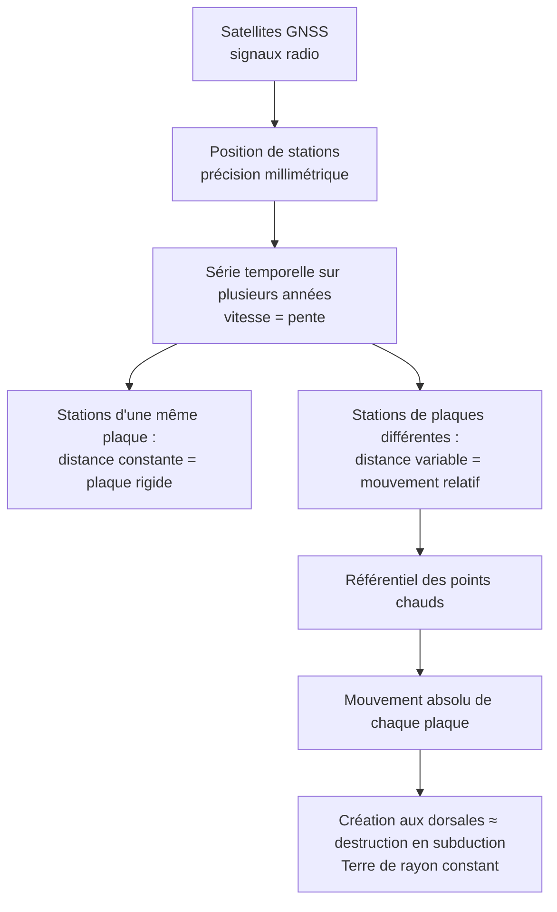

# Synthèse et fiche de révision : Mouvement actuel et absolu des plaques

## 1. Fiche de révision

### Les faits à savoir absolument

!!! abstract "Chiffres et valeurs de référence"
    | À connaître | Valeur |
    |---|---|
    | Vitesses des plaques | $\approx 1$ à $10\ \text{cm·an}^{-1}$ (jusqu'à $\approx 15$) |
    | Dorsale médio-atlantique | $\approx 2$ à $3\ \text{cm·an}^{-1}$ |
    | Dorsale est-Pacifique | $\approx 10$ à $15\ \text{cm·an}^{-1}$ |
    | Nazca - Amérique du Sud | $\approx 7$ à $8\ \text{cm·an}^{-1}$ |
    | Inde - Eurasie | $\approx 4$ à $5\ \text{cm·an}^{-1}$ |
    | Précision du GPS géodésique | quelques mm |
    | Surface créée aux dorsales | $\approx 3\ \text{km}^2\text{·an}^{-1}$ |
    | Conversions | $1\ \text{cm·an}^{-1} = 10\ \text{mm·an}^{-1} = 10\ \text{km·Ma}^{-1}$ |

!!! info "Définitions à savoir rédiger"
    - **Géodésie spatiale (GPS/GNSS)** : mesure de la position d'une station par les temps de propagation de signaux de plusieurs satellites ; la répétition des mesures donne sa vitesse.
    - **Mouvement relatif** : mouvement d'une plaque par rapport à une autre plaque.
    - **Mouvement absolu** : mouvement d'une plaque par rapport à un référentiel fixe, le manteau profond matérialisé par les points chauds.
    - **Référentiel des points chauds** : ensemble de points chauds considérés comme fixes entre eux.

### Propriétés à savoir utiliser

!!! abstract "Les relations du chapitre"
    $$d = c\,\Delta t \qquad v = \frac{\Delta d}{\Delta t} \qquad \vec{v}_{A/B} = \vec{v}_{A/H} - \vec{v}_{B/H}$$

    Approfondissement : $v = \omega\,R_T\,\sin\theta$.

### Schéma bilan

### Pièges à éviter (liste de contrôle)

!!! warning "Avant de rendre ta copie, vérifie que tu n'as pas écrit…"
    - [ ] Une vitesse de plaque **sans référentiel**.
    - [ ] Une vitesse relative obtenue en **comparant des normes** (c'est une **différence de vecteurs**).
    - [ ] « Le GPS mesure la vitesse des **plaques** » (celle de **stations**).
    - [ ] « Les points chauds sont **absolument** fixes » (**quasi** fixes).
    - [ ] Une vitesse **sans unité de temps** (« $2{,}5\ \text{cm}$ » au lieu de « $2{,}5\ \text{cm·an}^{-1}$ »).
    - [ ] Un calcul sans **conversion** (m, cm, mm ; ans, Ma).
    - [ ] « La Terre s'agrandit » (création compensée par destruction).
    - [ ] « Toutes les plaques vont dans le même sens ».
    - [ ] Une réponse **sans valeurs** tirées des documents.

### Réflexes pour l'analyse de documents

!!! tip "Méthode"
    1. **Repérer le référentiel** et les **unités**.
    2. **Calculer** la vitesse : $\Delta d / \Delta t$, en $\text{cm·an}^{-1}$.
    3. **Comparer** stations d'une même plaque (≈ 0) et de plaques différentes ($\neq 0$).
    4. **Composer** les vitesses si nécessaire (différence de vecteurs).
    5. **Conclure** en rappelant le **type de limite** et le **référentiel**.

---

## 2. Comprendre pourquoi, savoir quand l'utiliser, savoir démontrer

### 2.1 Pourquoi la distance entre deux stations prouve-t-elle la rigidité ?

- **Pourquoi** : si la plaque se déformait, les stations voisines **n'auraient pas la même vitesse** et leur distance varierait. Une distance **constante** (à $\approx 0{,}25\ \text{mm·an}^{-1}$ près) montre que la plaque **se déplace en bloc**.
- **Quand l'utiliser** : à chaque fois qu'un document compare **plusieurs stations** de la **même plaque** ou de plaques **différentes**.
- **Démonstration** : calcul de $\Delta d/\Delta t$ pour une paire intraplaque (≈ 0) et une paire interplaque ($\neq 0$).

### 2.2 Pourquoi faut-il deux types de mouvements (relatif et absolu) ?

- **Pourquoi** : le **relatif** décrit **ce qui se passe à une limite** (ouverture, convergence), mais ne dit **pas laquelle des plaques bouge**. L'**absolu** répond à cette question grâce à un **référentiel extérieur**.
- **Quand l'utiliser** : relatif pour décrire **une limite** ; absolu pour comparer **toutes les plaques dans un même repère**.
- **Démonstration** : $v_{\text{rel}} = v_{A/H} - v_{B/H}$, **indépendant** du référentiel.

### 2.3 Pourquoi les points chauds servent-ils de référence ?

- **Pourquoi** : ils sont alimentés par des **remontées du manteau profond**, **quasi fixes** (environ $1\ \text{cm·an}^{-1}$ ou moins) devant les plaques ($1$ à $10\ \text{cm·an}^{-1}$).
- **Limite** : la fixité est **approchée** ; c'est un **modèle**.

### 2.4 Pourquoi la Terre n'est-elle pas en expansion ?

- **Pourquoi** : la surface créée aux dorsales ($\approx 3\ \text{km}^2\text{·an}^{-1}$) est du même ordre que la surface détruite en subduction.
- **Démonstration** : calcul surface $=$ longueur $\times$ vitesse (avec **conversion** en km·an⁻¹), puis comparaison.

### 2.5 Ce qu'il faut être capable de faire seul(e)

!!! success "Auto-évaluation"
    - [ ] Je sais **expliquer** le principe du GPS et pourquoi il faut **quatre satellites**.
    - [ ] Je sais **calculer** une vitesse à partir de distances ou de positions.
    - [ ] Je sais **distinguer** mouvement relatif et absolu, et **composer** les vitesses.
    - [ ] Je sais **argumenter** la rigidité des plaques avec des **valeurs**.
    - [ ] Je connais les **ordres de grandeur** des vitesses.
    - [ ] Je sais faire un **bilan de surface** créée et détruite.

**Suite du cours** : Partie 3, *Le déplacement passé des plaques lithosphériques* (sédiments océaniques, points chauds).
