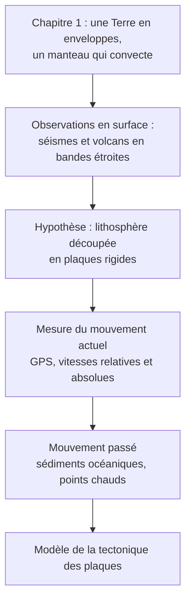

# Chapitre 2 : De la mobilité horizontale à la « tectonique des plaques »

!!! abstract "Problématique du chapitre"
    Comment l'étude de la **répartition des séismes et des volcans**, de **mesures de déplacement actuelles** et de **marqueurs du passé** (sédiments océaniques, points chauds) a-t-elle conduit à **découper la lithosphère en plaques mobiles** et à **mesurer leurs mouvements** ?

## Plan du chapitre

| Partie | Contenu | Statut |
|---|---|---|
| **1. Une lithosphère découpée en plaques** | Répartition de l'activité géologique (volcans explosifs et effusifs, séismes), notion de plaque lithosphérique | ✅ disponible |
| **2. Déterminer le mouvement actuel et absolu des plaques** | Principes (géodésie spatiale, repères), résultats | ✅ disponible |
| **3. Le déplacement passé des plaques** | Sédiments océaniques, points chauds | à venir |
| **Fiche de révision du contrôle** | Chapitres 1 et 2 : faits, pièges, méthodes | à venir |

## Fil conducteur

!!! tip "Comment utiliser ce cours"
    1. Lis d'abord la page **Objectifs et prérequis** de chaque partie.
    2. Étudie le cours, puis refais **sans regarder** les exemples corrigés.
    3. Fais les exercices progressifs, puis les exercices type contrôle **en temps limité**.
    4. Termine par la **synthèse** et la section « Comprendre, savoir quand l'utiliser, savoir démontrer ».

!!! info "Convention des encadrés"
    Identique au chapitre 1 : **Définition**, **Propriété / résultat**, **Point d'attention**, **Méthode**, **Exemple**, **Corrigé** (repliable).
