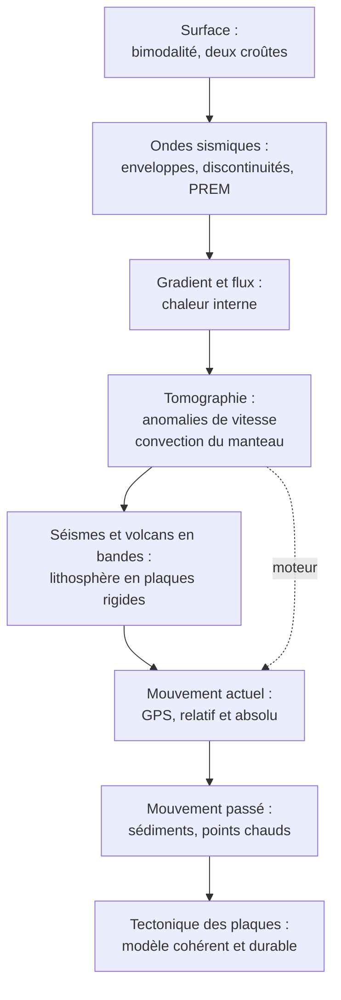

# Fiche de révision du contrôle : chapitres 1 et 2

!!! abstract "Comment utiliser cette fiche"
    Le contrôle est une **analyse de documents** : on ne te demande pas de réciter, mais de **tirer des conclusions de données** avec tes **connaissances**. Cette fiche te donne **ce qu'il faut savoir par cœur**, les **raisonnements types** et les **pièges**. Lis-la **après** avoir travaillé les cours, puis fais les [sujets blancs](sujets-blancs.md) et relis la [méthode](methode-analyse-documents.md).

---

## 1. Les chiffres à savoir absolument

### Chapitre 1

| Sujet | Valeur à retenir |
|---|---|
| Continents / océans | $\approx 29\ \%$ / $\approx 71\ \%$ de la surface |
| Altitude moyenne des continents | $\approx +840\ \text{m}$ |
| Profondeur moyenne des océans | $\approx -3800\ \text{m}$ |
| Modes de la bimodalité | $0$ à $+1000\ \text{m}$ et $-4000$ à $-5000\ \text{m}$ |
| Croûte continentale | $30$ à $35\ \text{km}$ ; $\approx 2{,}7\ \text{g·cm}^{-3}$ ; jusqu'à $\approx 4\ \text{Ga}$ ; granitoïdes, gneiss |
| Croûte océanique | $\approx 7\ \text{km}$ ; $\approx 2{,}9$ à $3{,}0\ \text{g·cm}^{-3}$ ; $\leq 180$ à $200\ \text{Ma}$ ; basaltes, gabbros |
| Manteau supérieur | péridotite ; $\approx 3{,}3\ \text{g·cm}^{-3}$ |
| Moho | $\approx 30$ à $35\ \text{km}$ (continent), $\approx 7\ \text{km}$ (océan) |
| Gutenberg / Lehmann | $\approx 2900\ \text{km}$ / $\approx 5150\ \text{km}$ |
| Zone d'ombre des ondes P | $103^\circ$ à $142^\circ$ ; ondes S absentes au-delà de $103^\circ$ |
| Vitesses des ondes | croûte : $V_P \approx 6$, $V_S \approx 3{,}5\ \text{km·s}^{-1}$ ; manteau sup. : $\approx 8$ et $4{,}5$ |
| Rayon de la Terre | $\approx 6371\ \text{km}$ |
| Foyers sismiques | de $0$ à $\approx 700\ \text{km}$ |
| Magnitude $+1$ | amplitude $\times10$, énergie $\times\approx32$ |
| Gradient géothermique | $\approx 30\ ^\circ\text{C·km}^{-1}$ (croûte), $\approx 0{,}3$ à $0{,}5$ (manteau convectif) |
| Isotherme de la lithosphère | $\approx 1300\ ^\circ\text{C}$ |
| Température au centre | $\approx 5000$ à $6000\ ^\circ\text{C}$ |
| Flux géothermique moyen | $\approx 87\ \text{mW·m}^{-2}$ ; puissance $\approx 44$ à $47\ \text{TW}$ |
| Part radioactive de la chaleur | environ la moitié |
| Mouvements du manteau | quelques $\text{cm·an}^{-1}$ |

### Chapitre 2

| Sujet | Valeur à retenir |
|---|---|
| Grandes plaques | $7$ |
| Lithosphère océanique / continentale | jusqu'à $\approx 100\ \text{km}$ / $\approx 100$ à $250\ \text{km}$ |
| Vitesses des plaques | $\approx 1$ à $10\ \text{cm·an}^{-1}$ (jusqu'à $\approx 15$) |
| Dorsale atlantique / est-Pacifique | $\approx 2$ à $3$ / $\approx 10$ à $15\ \text{cm·an}^{-1}$ |
| Précision du GPS géodésique | quelques mm |
| Surface créée aux dorsales | $\approx 3\ \text{km}^2\text{·an}^{-1}$ |
| Âge maximal du plancher océanique | $\approx 180$ à $200\ \text{Ma}$ |
| Pacifique par rapport à Hawaï | $\approx 7$ à $10\ \text{cm·an}^{-1}$, vers le nord-ouest |
| Coude Hawaï-Empereur | $\approx 47\ \text{Ma}$ |
| Silice : basalte / andésite | $\approx 50\ \%$ / $\approx 60\ \%$ |
| Conversion | $10\ \text{km·Ma}^{-1} = 1\ \text{cm·an}^{-1}$ |

---

## 2. Les définitions à savoir rédiger

!!! info "Chapitre 1"
    - **Bimodalité des altitudes** : distribution des altitudes présentant **deux modes** (continental et océanique) séparés par un creux.
    - **Roche magmatique** : formée par **refroidissement d'un magma** ; **plutonique** (lent, texture grenue) ou **volcanique** (rapide, microlitique).
    - **Roche métamorphique** : transformée **à l'état solide** par hausse de pression et/ou de température.
    - **Roche sédimentaire** : formée **en surface** par accumulation de sédiments puis diagenèse.
    - **Foyer / épicentre** : point de rupture en profondeur / point de la surface à sa verticale.
    - **Magnitude / intensité** : énergie libérée (une valeur) / effets en un lieu (plusieurs valeurs).
    - **Discontinuité sismique** : surface où la vitesse des ondes change **brusquement**.
    - **Modèle PREM** : modèle de référence **1D** de $V_P$, $V_S$, $\rho$, pression en fonction de la profondeur.
    - **Gradient géothermique** : augmentation de la température avec la profondeur.
    - **Flux géothermique** : énergie thermique traversant l'unité de surface par unité de temps ($\text{W·m}^{-2}$).
    - **Conduction / convection** : transfert **sans** / **avec** déplacement de matière.
    - **Tomographie sismique** : reconstitution 3D des **anomalies de vitesse** par rapport au modèle de référence.

!!! info "Chapitre 2"
    - **Lithosphère** : enveloppe rigide (croûte + manteau supérieur rigide), limitée par l'isotherme $1300\ ^\circ\text{C}$.
    - **Asthénosphère** : manteau sous la lithosphère, **solide mais ductile**.
    - **Plaque lithosphérique** : portion de lithosphère **rigide**, délimitée par des zones d'activité, **mobile** par rapport aux voisines.
    - **Volcanisme effusif / explosif** : coulées de lave fluide / projections, cendres, nuées ardentes.
    - **Mouvement relatif / absolu** : par rapport à une autre plaque / par rapport aux points chauds (repère quasi fixe).
    - **Point chaud** : volcanisme **intraplaque** au-dessus d'une **remontée de manteau chaud profond**, quasi fixe.
    - **Sédiment basal** : sédiment le plus profond, au contact du basalte (âge minimal du plancher).

---

## 3. Les formules

!!! abstract "À connaître et savoir utiliser"
    | Formule | Usage |
    |---|---|
    | $V_P = \sqrt{\dfrac{K+\frac43\mu}{\rho}}$ ; $V_S = \sqrt{\dfrac{\mu}{\rho}}$ | $\mu=0$ donc $V_S=0$ : liquide ; $V_P > V_S$ toujours |
    | $d = \Delta t_{S-P}\,\dfrac{V_PV_S}{V_P-V_S}$ | distance épicentrale (triangulation) |
    | $\dfrac{\sin i_1}{V_1}=\dfrac{\sin i_2}{V_2}$ | réfraction des ondes |
    | $\varphi = \lambda\,\dfrac{\Delta T}{\Delta z}$ ; $\varphi = P/S$ | flux et puissance |
    | $\dfrac{\Delta V}{V}=\dfrac{V_{\text{réelle}}-V_{\text{réf}}}{V_{\text{réf}}}$ | anomalie de vitesse |
    | $v=\dfrac{\Delta d}{\Delta t}$ | vitesse (GPS, expansion, points chauds) |
    | $\vec v_{A/B}=\vec v_{A/H}-\vec v_{B/H}$ | composition des vitesses |

    **Si l'énoncé donne la formule**, tu n'as qu'à l'**appliquer** (avec les **bonnes unités**) ; sinon, c'est qu'elle fait partie de celles à savoir.

---

## 3 bis. Tableaux comparatifs à maîtriser

### Les deux croûtes

| | **Continentale** | **Océanique** |
|---|---|---|
| Roches | granitoïdes, gneiss | basaltes, gabbros |
| Épaisseur | $30$ à $35\ \text{km}$ | $\approx 7\ \text{km}$ |
| Masse volumique | $\approx 2{,}7$ | $\approx 2{,}9$ à $3{,}0$ |
| Âge maximal | $\approx 4\ \text{Ga}$ | $\approx 180$ à $200\ \text{Ma}$ |
| Altitude | mode $0$ à $+1000\ \text{m}$ | mode $-4000$ à $-5000\ \text{m}$ |

### Les ondes P et S

| | **P** | **S** |
|---|---|---|
| Mouvement | parallèle à la propagation | perpendiculaire |
| Milieux | solides **et** liquides | **solides** seulement |
| Vitesse | plus rapides (arrivent **en premier**) | plus lentes |

### Les trois régimes et limites

| Régime | Faille | Limite | Contexte | Volcanisme |
|---|---|---|---|---|
| **Extensif** | normale | divergente | dorsale, rift | effusif |
| **Compressif** | inverse | convergente | subduction, collision | explosif (subduction) |
| **Coulissant** | décrochante | transformante | San Andreas | aucun |

### Les enveloppes

| Enveloppe | Profondeur | État |
|---|---|---|
| Croûte | $0$ à $7$-$70\ \text{km}$ | solide |
| Manteau | jusqu'à $2900\ \text{km}$ | **solide**, ductile à long terme (convection) |
| Noyau externe | $2900$ à $5150\ \text{km}$ | **liquide** ($V_S=0$) |
| Noyau interne | $5150$ à $6371\ \text{km}$ | **solide** |

---

## 4. Les raisonnements types (observation, propriété, conclusion)

!!! tip "À savoir refaire les yeux fermés"
    | Si le document montre… | On utilise… | On conclut… |
    |---|---|---|
    | Deux pics dans un histogramme des altitudes | bimodalité + roches + densités | **deux types de croûte** |
    | Absence d'ondes S dans une zone | $\mu=0 \Rightarrow V_S=0$ | zone **liquide** (noyau externe) |
    | Zone d'ombre des ondes P ($103^\circ$ à $142^\circ$) | réfraction (Snell-Descartes) | **discontinuité** (Gutenberg) |
    | Ondes P réfléchies dans la zone d'ombre | saut de $V_P$ à $5150\ \text{km}$ | **graine solide** (Lehmann) |
    | Saut de $V_P$ vers $30$ à $35\ \text{km}$ | changement de roches | **Moho** (croûte/manteau) |
    | Décalage S-P à 3 stations | $d=\Delta t\,V_PV_S/(V_P-V_S)$ | **épicentre** par triangulation |
    | Gradient fort puis faible | conduction puis convection | **lithosphère** puis **manteau convectif** |
    | Flux élevé localement | gradient fort, lithosphère mince | **remontée de matière chaude** |
    | Anomalie **positive** de vitesse | plus rapide $\Rightarrow$ plus **froid** | matière qui **plonge** |
    | Anomalie **négative** | plus lente $\Rightarrow$ plus **chaud** | matière qui **remonte** |
    | Anomalies froides et chaudes organisées | boucle de matière | **convection mantellique** |
    | Séismes et volcans en bandes étroites | zones actives / régions asismiques | **plaques rigides** |
    | Lave visqueuse, riche en silice et eau | gaz piégés | volcanisme **explosif** (subduction) |
    | Lave basaltique fluide | gaz libérés | volcanisme **effusif** (dorsale, point chaud) |
    | Distance GPS constante entre deux stations | plaque rigide | **même plaque** |
    | Distance GPS qui varie | mouvement relatif | **limite** de plaques |
    | Âge des sédiments croissant avec la distance | $v=d/T$ | **expansion**, à doubler pour l'ouverture |
    | Chaîne de volcans d'âge croissant | plaque mobile / point chaud fixe | **mouvement absolu** (direction et vitesse) |
    | Vitesses passées $\approx$ vitesses GPS | méthodes indépendantes | mouvement **durable** |

---

## 5. Les pièges les plus fréquents (top 25)

!!! warning "Roches et croûtes"
    1. **Basalte** = volcanique (microlitique), **gabbro** = plutonique (grenu), **même composition**.
    2. **Gneiss** = métamorphique (foliée), pas magmatique, ni « un granite ».
    3. **Granite** : quartz, feldspaths, micas, **sans olivine**.
    4. La croûte océanique est plus **basse** à cause de l'**épaisseur ET de la densité**, pas de l'épaisseur seule.
    5. Le **plateau continental** est **continental**.

!!! warning "Sismologie et structure de la Terre"
    6. Les ondes S **ne se propagent pas** dans un liquide (elles ne sont pas « absorbées »).
    7. La zone d'ombre est due à la **réfraction**, pas à l'absorption.
    8. Le **manteau** est **solide** (les ondes S le traversent).
    9. **Moho** (croûte/manteau, chimique) $\neq$ **limite lithosphère/asthénosphère** (mécanique).
    10. **Magnitude** (énergie, un nombre) $\neq$ **intensité** (effets, chiffres romains).
    11. Le **PREM** est un **modèle déduit**, **1D**, pas une mesure directe.
    12. La vitesse **dépend de $K$, $\mu$ et $\rho$** ensemble : $V_P$ chute à $2900\ \text{km}$ alors que $\rho$ augmente.

!!! warning "Thermique et tomographie"
    13. Le **gradient n'est pas constant** (extrapoler $30\ ^\circ\text{C·km}^{-1}$ au centre donne $190\,000\ ^\circ\text{C}$).
    14. **Flux** ($\text{W·m}^{-2}$) $\neq$ **puissance** (W) $\neq$ **gradient** ($^\circ\text{C·km}^{-1}$).
    15. **Positive = rapide = froid** (pas « chaud »).
    16. La **tomographie** mesure des **vitesses**, pas la température ni les mouvements.

!!! warning "Plaques et mouvements"
    17. **Lithosphère** $\neq$ **croûte** ; **plaque** $\neq$ **continent**.
    18. L'**asthénosphère** n'est **pas du magma**.
    19. **Effusif** = dorsale, point chaud ; **explosif** = subduction (jamais l'inverse).
    20. **Collision** : pas d'arc volcanique ; **transformante** : ni création ni destruction.
    21. **Toujours** préciser le **référentiel** d'une vitesse de plaque.
    22. Une vitesse **relative** s'obtient par **différence de vecteurs**.
    23. **Demi-vitesse** (un côté) $\neq$ **ouverture** (somme).
    24. **Basaltes** datés par **radiochronologie**, pas par fossiles.
    25. Ce n'est pas le **point chaud** qui bouge, c'est la **plaque** ; le volcan le plus **ancien** est le plus **éloigné**.

---

## 6. Les erreurs d'unités

!!! danger "Contrôle d'unités systématique"
    - **Conversions de vitesses** : $1\ \text{cm·an}^{-1} = 10\ \text{mm·an}^{-1} = 10\ \text{km·Ma}^{-1} = 10^{-5}\ \text{km·an}^{-1}$.
    - **Densités** : $\text{g·cm}^{-3} \to \text{kg·m}^{-3}$ ($\times1000$) ; **vitesses d'ondes** : $\text{km·s}^{-1} \to \text{m·s}^{-1}$ ($\times1000$) avant de calculer $\mu$ et $K$ ($\text{Pa}$).
    - **Gradients** : $^\circ\text{C·km}^{-1} \to \text{K·m}^{-1}$ ($\div1000$) avant d'appliquer la loi de Fourier.
    - **Flux** : $\text{mW·m}^{-2} \to \text{W·m}^{-2}$ ($\div1000$).
    - **Écriture d'une vitesse** : toujours une **unité de temps** (« $2{,}5\ \text{cm·an}^{-1}$ », jamais « $2{,}5\ \text{cm}$ »).

---

## 7. Check-list avant de rendre la copie

!!! success "Dix vérifications"
    - [ ] J'ai répondu **exactement** à la question posée (verbe de consigne respecté).
    - [ ] J'ai **utilisé tous les documents** et je les ai **cités** (« d'après le document 2… »).
    - [ ] J'ai donné **au moins une valeur chiffrée** par document.
    - [ ] J'ai **interprété** (observation $\to$ propriété $\to$ conclusion), sans simplement **décrire**.
    - [ ] J'ai mobilisé **au moins une connaissance** du cours **à bon escient**.
    - [ ] J'ai **croisé** au moins deux documents.
    - [ ] Mes **calculs** ont des **unités** converties et un **résultat avec unité**.
    - [ ] J'ai précisé le **référentiel** et distingué **relatif / absolu** quand c'était utile.
    - [ ] Ma **conclusion** répond à la question et est **cohérente** avec le raisonnement.
    - [ ] J'ai **relu** : phrases complètes, vocabulaire scientifique précis.

---

## 8. Ce qui n'est pas exigible, sauf si l'énoncé le donne

!!! note "Pour ne pas t'inquiéter inutilement"
    Les éléments suivants sont des **approfondissements** du cours. Ils t'aident à **comprendre**, mais ne sont **à utiliser en contrôle que si les données et formules sont fournies** :

    - le modèle d'**isostasie** chiffré (formule de l'altitude $e$) ;
    - le calcul de la **profondeur du Moho** par la distance critique ;
    - la **rotation d'Euler** ($v=\omega R\sin\theta$) ;
    - les **anomalies magnétiques** ;
    - la production des magmas (fusion par décompression, par hydratation) en détail ;
    - la sensibilité vitesse/température ($\approx 1\ \%$ pour $100\ ^\circ\text{C}$) : à connaître **si donnée**.

    **Reste prioritaire** : savoir **raisonner** avec les documents, les **chiffres de référence** et les **raisonnements types** de la section 4.

---

## 9. Schéma de synthèse global

