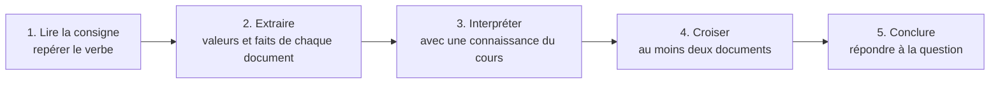

# Méthode : réussir une analyse de documents

!!! abstract "Principe"
    Une analyse de documents évalue ta capacité à **extraire** des informations de documents, à les **interpréter** avec tes **connaissances**, à les **croiser** et à **conclure** par un **texte argumenté**. La note ne récompense **ni** la récitation du cours **ni** la simple description : elle récompense le **raisonnement**.

## 1. Les cinq temps de la méthode

### Temps 1 : lire la consigne

!!! info "Verbes de consigne"
    | Verbe | Ce qu'on attend |
    |---|---|
    | **Montrer / démontrer** | enchaîner des arguments qui **établissent** la conclusion donnée |
    | **Justifier** | appuyer une affirmation sur des **données** et des **connaissances** |
    | **Expliquer** | donner la **cause** ou le **mécanisme** |
    | **Comparer** | relever **ressemblances et différences**, **chiffrées** |
    | **Déduire** | tirer une **conséquence logique** d'un résultat précédent |
    | **Calculer** | **formule, application numérique, résultat avec unité** |
    | **Discuter** | **argumenter** et **nuancer** (limites, hypothèses) |
    | **Décrire** | **dire ce qu'on voit**, sans interpréter (à ne pas confondre avec expliquer) |

### Temps 2 : extraire

!!! tip "Pour chaque document"
    1. **Nature** et **titre** (graphique, tableau, coupe, carte, texte).
    2. **Variables** et **unités** (axes, légende).
    3. **Valeurs clés** (maxima, minima, sauts, tendances, valeurs nulles).
    4. **Ce qui change** et **ce qui reste constant**.

### Temps 3 : interpréter

!!! tip "La chaîne de raisonnement"
    **Observation chiffrée** $\to$ **propriété ou connaissance du cours** $\to$ **conclusion partielle**.

    Exemple : « Les ondes S disparaissent au-delà de $103^\circ$ (doc. 1). Or elles ne se propagent pas dans un liquide ($\mu=0$). Donc une enveloppe liquide existe en profondeur. »

### Temps 4 : croiser

!!! tip "Le croisement, c'est ce qui rapporte le plus"
    Deux informations **de documents différents** se **renforcent** ou se **complètent** : « Le document 2 donne la vitesse actuelle ($2{,}5\ \text{cm·an}^{-1}$), le document 1 la vitesse sur $70\ \text{Ma}$ ($2{,}5\ \text{cm·an}^{-1}$) : le mouvement est **durable**. »

### Temps 5 : conclure

!!! tip "Une conclusion qui répond à la question"
    Reprends la **question**, réponds en **une ou deux phrases**, **sans nouvelle donnée**. Si on demande « montrer que… », termine par « **Ainsi,** … ».

## 2. Gabarit de rédaction

!!! example "Plan type (8 à 12 lignes)"
    1. **Phrase d'introduction** : reformuler le problème en une phrase.
    2. **Document A** : « D'après le document 1, … (valeur). » $\to$ « Or, … (connaissance). » $\to$ « Donc … »
    3. **Document B** : même démarche.
    4. **Croisement** : « Le document 3 confirme que… »
    5. **Conclusion** : « Ainsi, … »

!!! info "Connecteurs utiles"
    **d'après le document…** ; **on observe que…** ; **or…** ; **cela signifie que…** ; **donc / par conséquent…** ; **en revanche…** ; **de plus…** ; **ce résultat est cohérent avec…** ; **toutefois…** (nuance) ; **ainsi…** (conclusion).

## 3. Modèles de phrases selon le type de document

!!! example "Histogramme ou tableau d'altitudes"
    « Le document montre deux modes : $22\ \%$ de la surface entre $0$ et $+1000\ \text{m}$ et $23\ \%$ entre $-4000$ et $-5000\ \text{m}$, avec peu de surface entre les deux. La distribution est donc bimodale. »

!!! example "Sismogrammes ou tableau d'ondes"
    « Au-delà de $103^\circ$, aucune onde S n'est enregistrée, alors que les ondes P le sont jusqu'à $103^\circ$ puis à partir de $142^\circ$. L'absence d'ondes S signale une enveloppe liquide, la déviation des ondes P explique la zone d'ombre. »

!!! example "Coupe tomographique"
    « Le document montre une anomalie positive de $+2\ \%$ en forme de panneau incliné. Une onde plus rapide traverse un matériau plus froid : il s'agit d'une plaque lithosphérique froide qui plonge. »

!!! example "Série GPS ou distances entre stations"
    « La distance entre les stations A et B varie de $0{,}24\ \text{m}$ en huit ans, soit $3{,}0\ \text{cm·an}^{-1}$ ; elles sont sur des plaques différentes. Celle entre C et D ne varie que de $2\ \text{mm}$ : même plaque, rigide. »

!!! example "Âges de forages ou de volcans"
    « L'âge augmente avec la distance : $v=d/T$ donne $12{,}5\ \text{km·Ma}^{-1}$ soit $1{,}25\ \text{cm·an}^{-1}$ par côté, donc une ouverture de $2{,}5\ \text{cm·an}^{-1}$. »

## 4. Les erreurs qui coûtent des points

!!! warning "À éviter absolument"
    - **Décrire** au lieu d'**interpréter**.
    - **Paraphraser le cours** sans **s'appuyer** sur les documents.
    - **Oublier un document** ou **ne pas le citer**.
    - **Ne citer aucune valeur** : « les ondes sont différentes » ne vaut rien ; « $V_S = 0$ à $3000\ \text{km}$ » vaut beaucoup.
    - **Mélanger** les référentiels, les unités, ou **oublier** les unités du résultat.
    - **Conclure à côté** de la question (hors sujet).
    - **Affirmer sans nuancer** quand l'énoncé demande de **discuter**.
    - Une **copie illisible** ou sans phrases (liste de mots-clés).

## 5. Gestion du temps (pour un contrôle d'environ une heure)

!!! tip "Répartition indicative"
    | Étape | Durée |
    |---|---|
    | Lecture de la consigne et des documents | $5$ à $8$ min |
    | Brouillon : colonnes « donnée / connaissance / conclusion » | $5$ min |
    | Rédaction | $15$ à $20$ min |
    | Relecture (unités, valeurs, conclusion) | $5$ min |

    **Astuce** : sur ton brouillon, fais un **tableau** à trois colonnes : **ce que dit le document**, **ce que je sais**, **ce que j'en conclus**. Ta rédaction n'est plus qu'une **mise en phrases**.

## 6. Exemple complet commenté

!!! example "Question"
    *Montrer que le noyau externe est liquide.* Document 1 : « Les ondes S ne sont pas enregistrées au-delà de $103^\circ$ de l'épicentre. » Document 2 : $V_S = \sqrt{\mu/\rho}$ ; un liquide a $\mu=0$.

??? success "Réponse commentée"
    > **(Observation chiffrée)** Le document 1 indique que les ondes S ne sont plus enregistrées au-delà de $103^\circ$ de distance angulaire. **(Propriété)** D'après le document 2, $V_S=\sqrt{\mu/\rho}$ : une onde S ne se propage que dans un milieu de rigidité non nulle, un liquide ($\mu=0$) ne la transmet pas. **(Croisement)** Au-delà de $103^\circ$, les ondes ont donc traversé un milieu dont $\mu=0$. **(Conclusion)** Ainsi, la Terre possède en profondeur une enveloppe liquide : le noyau externe.

    **Pourquoi c'est une bonne réponse** : une valeur chiffrée ($103^\circ$), une propriété citée avec le document, un croisement, une conclusion qui répond à « montrer que ».
